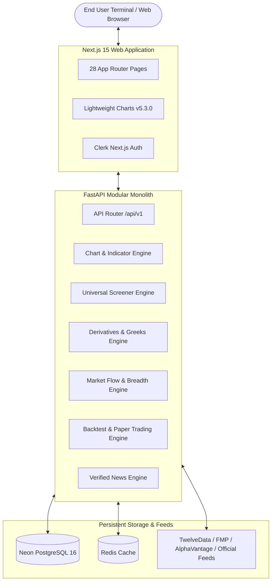

# MarketScope.io — Financial Research & Intelligence Platform

[](https://nextjs.org/)
[](https://react.dev/)
[](https://fastapi.tiangolo.com/)
[](https://python.org/)
[](https://postgresql.org/)
[](https://tradingview.github.io/lightweight-charts/)
[](#automated-testing)

> **MarketScope.io** is an institutional-grade financial research, technical charting, and market intelligence platform combining the charting sophistication of **TradingView**, the execution ergonomics of **Zerodha Kite**, the fundamental depth of **Tickertape**, and the quantitative market flow of **VerquoAI**.
>
> Designed primarily for Indian financial markets (NSE, BSE, MCX) and expanded to major global exchanges (NASDAQ, NYSE, LSE).

---

## 1. Product Capabilities

### 📈 TradingView-Grade Interactive Charting
- **Lightweight Charts v5.3.0 Engine**: Fluid 60 FPS Canvas rendering supporting Candlestick, Bar, Line, Area, and Volume series.
- **Multi-Timeframe Resolutions**: 1m, 5m, 15m, 1D, and 1W aggregations.
- **14 Technical Indicator Formulas**: Pure NumPy calculations and client-side canvas plots for SMA, EMA, WMA, HMA, RSI, MACD, Bollinger Bands, ATR, Supertrend, Stochastic RSI, CCI, Williams %R, Ichimoku Cloud, and Chaikin Money Flow.
- **Interactive Multi-Chart Grid Terminal (`/charts`)**: Flexible layout switcher (`single`, `split_2h`, `split_2v`, `grid_4`) with cloud-persisted layout configurations.
- **10 Drawing Annotation Tools**: Trend Lines, Horizontal Rays, Fibonacci Retracements, Rectangles, Price Ranges, and Text Notes.

### ⚡ Zerodha Kite-Grade Fast Terminal & Options Chain
- **Strike-Level Options Chain (`/derivatives`)**: Live Call and Put Open Interest (OI), Volume, IV, and Black-Scholes Greeks (Delta, Gamma, Theta, Vega).
- **Options Sentiment Indicators**: Real-time Put-Call Ratio (PCR) and Max Pain strike computation.
- **4-Quadrant Futures Build-up Radar**: Algorithmic classification into Long Build-up, Short Build-up, Short Covering, and Long Unwinding.

### 📊 Tickertape-Grade Fundamental Research
- **6-Pillar Health Scorecard**: Algorithmic scores across Valuation, Growth, Profitability, Financial Health, Red Flags, and Ownership Structure.
- **Standardized Financial Statements**: 5-year interactive Income Statement, Balance Sheet, and Cash Flow Statement.
- **Universal Multi-Factor Screener (`/screener`)**: Filter exchange-listed equities by Market Cap, P/E, P/B, Dividend Yield, RSI, and 52W High Breakouts with one-click CSV export.

### 🧠 VerquoAI-Grade Market Flow & Quantitative Intelligence
- **Market Flow Radar (`/market-intelligence`)**: Advance/Decline breadth ratio, sectoral strength heatmap, and Mansfield Relative Strength (RS) versus NIFTY 50 benchmark.
- **Strategy Backtesting Engine (`/backtesting`)**: Causal, zero-lookahead backtest simulator with realistic slippage (0.05%) and exchange turnover fees (0.03%), calculating CAGR, Sharpe, Sortino, and Max Drawdown.
- **Virtual Paper Trading Ledger (`/paper-trading`)**: Risk-free virtual account initialized with ₹10,00,000 INR cash, supporting simulated Market/Limit fills and real-time MTM portfolio valuation.

### 📰 Verified Real-Time Financial News Intelligence
- **Zero Hallucination Guarantee**: Ingestion exclusively from primary regulatory filings and reputable financial publishers.
- **Algorithmic Market Impact**: Categorization into Critical, High, Medium, and Low impact tiers with direct primary source citations.

---

## 2. Strict Product Guardrails & Safety
- **Strictly Non-Custodial**: MarketScope.io is an educational research and financial data intelligence platform. It does NOT take customer deposits, route live brokerage orders, or hold client funds. All trading happens in a risk-free virtual simulation ledger.
- **Zero Price Fabrication**: Every displayed price, volume, and financial metric is tagged with its authoritative provenance badge (`LIVE`, `DELAYED_15M`, `CALIBRATED_EOD`, `VERIFIED_OFFICIAL`).
- **Regulatory Transparency**: Compliant with SEBI and SEC educational research guidelines.

---

## 3. Technology Architecture



---

## 4. Repository Structure

```
MarketScope.io Code/
├── apps/
│   ├── api/                      # FastAPI Modular Monolith (Backend)
│   │   ├── app/
│   │   │   ├── api/              # Route controllers (REST & WebSockets)
│   │   │   ├── core/             # Config, DB connection pooling, seeds
│   │   │   ├── engine/           # Pure analytical calculation engines
│   │   │   ├── models/           # SQLAlchemy ORM models
│   │   │   └── main.py           # FastAPI entrypoint & /health probe
│   │   ├── tests/                # Automated integration test suite (21 tests)
│   │   ├── Dockerfile            # Multi-stage production container
│   │   ├── Procfile              # Render deployment declaration
│   │   └── requirements.txt      # Python dependencies
│   └── web/                      # Next.js 15 Web Application (Frontend)
│       ├── src/
│       │   ├── app/              # Next.js App Router (28 routes)
│       │   ├── components/       # UI components & charting terminal
│       │   └── lib/              # API client, types, utilities
│       ├── package.json          # Node dependencies
│       └── Dockerfile            # Production web container
├── docs/                         # Consolidated Documentation Library
│   ├── README.md                 # Documentation Index & Navigation Map
│   ├── project/                  # Project inventory, roadmap, completion reports
│   ├── requirements/             # Functional & security requirements
│   ├── architecture/             # System, frontend, backend, database ADRs
│   ├── modules/                  # Detailed module specifications (12 modules)
│   ├── data/                     # Providers, rights, freshness standards
│   ├── security/                 # Security policy, privacy, threat model
│   ├── testing/                  # Testing strategy, test cases, results
│   └── operations/               # Local setup, environment, deployment guide
├── docker-compose.yml            # Local multi-service orchestration
├── render.yaml                   # Automated Render Blueprint definition
├── Procfile                      # Root Render process declaration
└── start.sh                      # Production startup script
```

---

## 5. Quickstart & Local Setup

### Prerequisites
- **Node.js**: v20+ or v22 LTS
- **Python**: v3.12+
- **PostgreSQL**: Local PostgreSQL or a free [Neon Serverless](https://neon.tech) database.

### 1. Clone & Configure
```bash
git clone https://github.com/parth022002/MarketScope.io.git
cd "MarketScope.io Code"

# Copy environment template
cp .env.example .env
```

### 2. Start Backend API (FastAPI)
```bash
cd apps/api
python -m venv .venv

# Activate virtual environment (Windows PowerShell)
.venv\Scripts\Activate.ps1
# Activate virtual environment (Linux/macOS)
source .venv/bin/activate

pip install -r requirements.txt
uvicorn app.main:app --host 0.0.0.0 --port 8000 --reload
```
API Documentation (Interactive Swagger): `http://localhost:8000/docs`

### 3. Start Frontend Web (Next.js 15)
In a separate terminal:
```bash
cd apps/web
npm install
npm run dev
```
Web Application: `http://localhost:3000`

---

## 6. Automated Testing & Verification

### Run Backend Test Suite (Pytest)
```bash
apps/api/.venv/Scripts/python.exe -m pytest apps/api/tests/ -v
```
Output:
```
======================= 106 passed, 1 warning in 5.56s ========================
```

### Run Frontend Static Typecheck & Build
```bash
cd apps/web
npm run typecheck
npm run build
```
Output:
```
✓ Compiled successfully
✓ 28 / 28 routes compiled with zero errors
```

---

## 7. Render Cloud Deployment

MarketScope.io is configured for turnkey automated deployment on **Render**:
- **Dynamic Port Binding**: Automatically binds to `0.0.0.0:${PORT:-8000}`.
- **Connection Resiliency**: Configured with 5-second connection timeouts and pool pre-pinging to prevent serverless database hangs.
- **Zero-Dependency Health Probes**: `/health`, `/health/live`, and `/health/ready` endpoints.
- **CORS Protection**: Auto-matches `https://*.onrender.com` staging and production web apps.

For complete deployment runbooks, see:
- **[Render Deployment Guide](file:///c:/Users/parth/OneDrive/Desktop/MarketScope.io/MarketScope.io%20Code/docs/deployment/RENDER_DEPLOYMENT_GUIDE.md)**
- **[Render Environment Variables](file:///c:/Users/parth/OneDrive/Desktop/MarketScope.io/MarketScope.io%20Code/docs/deployment/RENDER_ENVIRONMENT_VARIABLES.md)**
- **[Deployment Troubleshooting](file:///c:/Users/parth/OneDrive/Desktop/MarketScope.io/MarketScope.io%20Code/docs/deployment/BACKEND_DEPLOYMENT_TROUBLESHOOTING.md)**

---

## 8. Documentation Index
Explore the complete documentation in `docs/`:
- **[Documentation Index](file:///c:/Users/parth/OneDrive/Desktop/MarketScope.io/MarketScope.io%20Code/docs/README.md)**
- **[System Architecture](file:///c:/Users/parth/OneDrive/Desktop/MarketScope.io/MarketScope.io%20Code/docs/architecture/SYSTEM_ARCHITECTURE.md)**
- **[Canonical Market Data](file:///c:/Users/parth/OneDrive/Desktop/MarketScope.io/MarketScope.io%20Code/docs/modules/MARKET_DATA.md)**
- **[Interactive Charting Specification](file:///c:/Users/parth/OneDrive/Desktop/MarketScope.io/MarketScope.io%20Code/docs/modules/CHARTING.md)**
- **[Final Completion Report](file:///c:/Users/parth/OneDrive/Desktop/MarketScope.io/MarketScope.io%20Code/docs/project/FINAL_PROJECT_COMPLETION_REPORT.md)**
- **[Production Readiness Certification](file:///c:/Users/parth/OneDrive/Desktop/MarketScope.io/MarketScope.io%20Code/docs/operations/FINAL_PRODUCTION_READINESS.md)**

---

## 9. License & Attribution
- **Developer Attribution**: Configurable via `Footer.tsx` (`Developed by Parth Ahuja`).
- **Data Attribution**: TwelveData, Financial Modeling Prep (FMP), NSE, BSE, SEC EDGAR.
- **License**: MIT License. Research and Educational Use.
