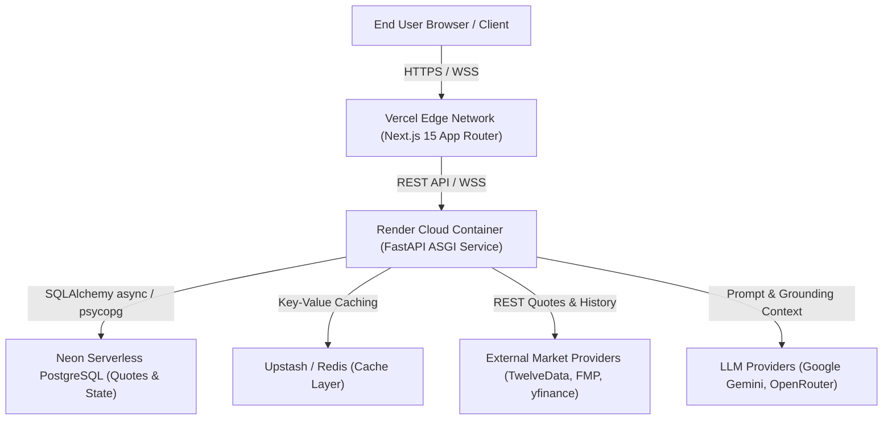

# MarketScope.io — System Architecture Reference

## 1. High-Level Architecture Overview

MarketScope.io is architected as an institutional-grade, decoupled monorepo composed of a modern Next.js 15 App Router frontend and an asynchronous Python FastAPI backend, backed by PostgreSQL (Neon Cloud) for persistent relational storage, in-memory caching, and live financial WebSocket feeds.



---

## 2. Monorepo Structure

```
marketscope/
├── apps/
│   ├── api/                     # Python 3.12+ FastAPI Microservice
│   │   ├── app/
│   │   │   ├── api/             # API Routers (REST & WebSockets)
│   │   │   ├── core/            # Config, Security, DB session, Middlewares
│   │   │   ├── domain/          # Pydantic schemas & SQLAlchemy ORM models
│   │   │   ├── engine/          # Business logic, Q-Intelligence, Indicators
│   │   │   ├── providers/       # Financial data connectors (TwelveData, FMP, yfinance)
│   │   │   ├── services/        # AI Assistant, Screener, Alerts, Paper trading
│   │   │   └── main.py          # Application entrypoint & lifespan events
│   │   ├── tests/               # 148 automated unit & integration tests
│   │   └── requirements.txt     # Python production dependencies
│   │
│   └── web/                     # Next.js 15 + TypeScript Frontend
│       ├── public/              # Static assets, logos, and icons
│       └── src/
│           ├── app/             # App Router pages (overview, markets, research, etc.)
│           ├── components/      # UI components (Header, Sidebar, MarketTicker, Charts)
│           ├── context/         # Auth, Watchlist & Portfolio providers
│           ├── hooks/           # useMarketData, useWebSocket, useWatchlist
│           ├── lib/             # API client, WebSocket managers, formatting helpers
│           └── types/           # TypeScript interface definitions
│
├── docs/                        # Architecture, reports, registers, diagrams, and assets
└── packages/                    # Shared configurations and utility modules
```

---

## 3. Real-Time Data Pipeline & Ingestion Architecture

### Multi-Tier Provider Failover
1. **Primary Provider (TwelveData & FMP):** High-precision real-time quotes, technical indicators, and validated financial statements.
2. **Secondary Provider (Live Exchange Provider / yfinance):** Real-time tick ingestion, intraday price snapshots, and currency cross-rates.
3. **Database Cache & Persistence (Neon PostgreSQL):**
   - The `market_quotes` relational table stores symbol, price, change, percent change, volume, high, low, open, previous close, and ISO timestamp.
   - Background worker in `main.py` synchronizes benchmark quotes every 15 seconds.
4. **Resilient Local Mock / Fallback:** Guarantees zero downtime and deterministic testing environments even during market holidays or upstream provider outages.

---

## 4. Frontend State & Rendering Architecture

- **Server-Side & Client Hybrid:** Uses Next.js 15 client components (`"use client"`) with optimized hydration for real-time tickers, interactive Canvas/SVG charts, and dynamic filtering.
- **WebSocket Tick Broadcaster:** Resilient WebSocket client with automatic reconnection, heartbeat ping/pong, and duplicate suppression.
- **Defensive Layout Constraints:** Every page wrapper uses explicit `min-w-0 max-w-full w-full overflow-hidden` classes to prevent flex blowout when hosting animated tickers or high-density tables.
- **Theme & 3D Layering:** The three-dimensional interactive background canvas runs in a designated viewport layer (`z-0`) with subtle opacity, ensuring all dashboard elements (`z-10`) maintain full interactivity and contrast.
