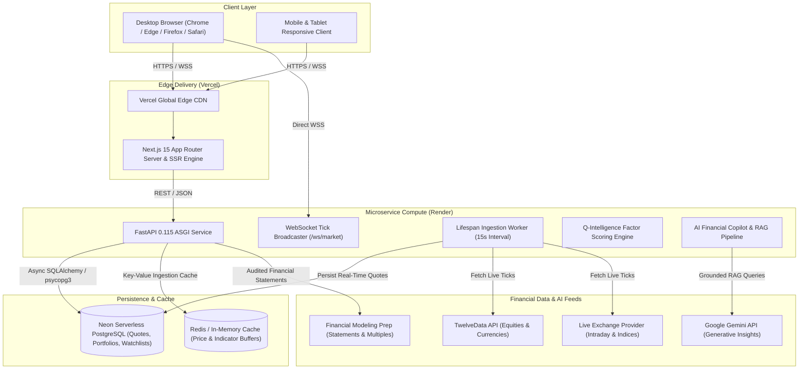

# MarketScope.io — System Architecture Specification

## 1. Executive Summary

MarketScope.io is designed as an institutional-grade, cloud-native financial intelligence platform. It features an event-driven, decoupled monorepo architecture engineered for sub-second page loads, real-time market data streaming, fault-tolerant ingestion pipelines, and deterministic quantitative modeling.

---

## 2. Global Architecture Flowchart

---

## 3. Layered Component Boundaries

### A. Presentation Layer (`apps/web`)
- **Framework:** Next.js 15 (React 19, TypeScript strict mode).
- **Styling & Assets:** Tailwind CSS, Lucide icons, interactive Canvas/SVG charting.
- **Layout Management:** Global responsive grid with explicit `min-w-0 max-w-full w-full overflow-hidden` bounds to prevent flex blowouts.
- **Background Layering:** Interactive Three.js geometric background positioned on `z-0` with `pointer-events-none` styling; analytical widgets render on `z-10`.

### B. Business Logic & API Layer (`apps/api`)
- **Runtime:** Python 3.12+ ASGI service powered by FastAPI and Uvicorn.
- **Subsystems:**
  - `MarketDataService`: Canonical instrument resolution, live price streaming, and DB caching.
  - `QIntelligenceService`: Multi-factor quantitative scoring (0–100 percentile rank).
  - `IndicatorEngine`: Technical indicator computations (SMA, EMA, RSI, MACD, Bollinger Bands, ATR, Supertrend).
  - `PaperTradingService`: Double-entry accounting for simulated trade fills and portfolio margins.
  - `AIAssistantService`: Retrieval-Augmented Generation with strict citation grounding and PII protection.

### C. Data Persistence Layer (Neon Cloud)
- **Engine:** Serverless PostgreSQL cluster.
- **Models:**
  - `market_quotes`: Relational store for real-time tickers (`symbol`, `price`, `change`, `percent_change`, `high`, `low`, `volume`, `updated_at`).
  - `users`: Core profile and identity records.
  - `watchlists` & `watchlist_items`: Relational multi-watchlist management.
  - `paper_portfolios`, `paper_positions`, `paper_orders`: Relational ledger for virtual executions.
  - `alerts`: Price condition triggers and execution history.
  - `chart_layouts`: Stored user drawings, intervals, and active indicators.

### D. Caching & Buffering Layer
- High-frequency prices, tick packages, and calculated technical indicators are buffered with configurable TTLs (15s to 300s) to guard upstream API rate limits and minimize latency.
