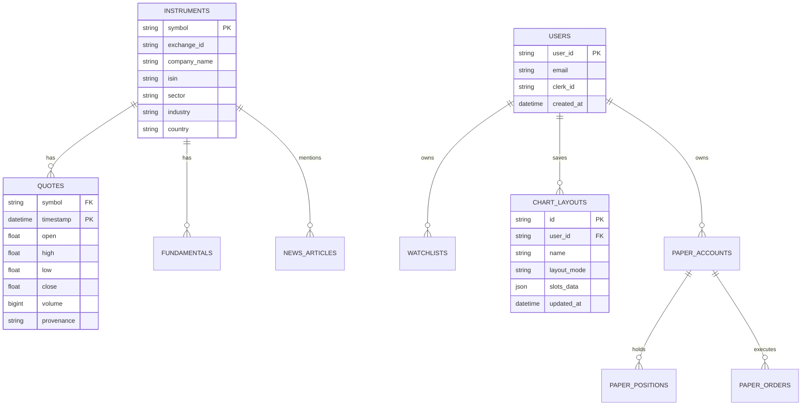

# MarketScope.io — Database Architecture

## 1. Overview
MarketScope.io uses **PostgreSQL 16** (hosted on **Neon Serverless**) managed via **SQLAlchemy 2.0** and **Alembic** migrations.

## 2. Relational Schema Design

## 3. Indexing & Optimization Strategy
- **Composite Index**: `(symbol, timestamp DESC)` on `QUOTES` table to provide O(log N) bar retrieval for charting.
- **Trigram Search Index**: `GIN` trigram indexes on `INSTRUMENTS.company_name` and `INSTRUMENTS.symbol` for instant sub-10ms universal search queries.
- **Connection Pool Tuning**: `pool_pre_ping=True`, `pool_recycle=300`, `pool_size=5`, `max_overflow=10`, and `connect_timeout=5` prevent dropped connections when Neon PostgreSQL resumes from idle sleep.
