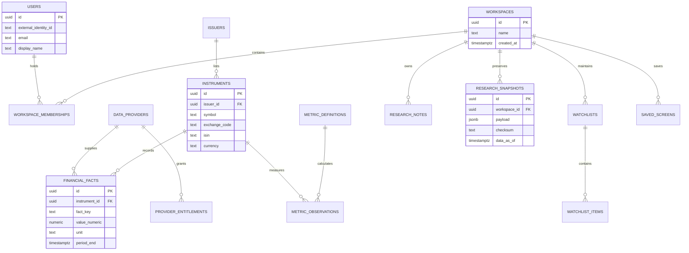

# Database Architecture Specification
**Platform:** MarketScope.io  
**Database Engine:** PostgreSQL 16 (Neon Serverless Compatible)  

## 1. Relational Entity-Relationship Diagram

## 2. Pooling & Resilience Configuration
- Managed via `app.core.database.py` with SQLAlchemy 2.0 and modern Psycopg 3.
- `pool_size=5`, `max_overflow=10`, `pool_recycle=300`, `pool_pre_ping=True` preventing stale pooled connections on serverless Neon.
- Serverless SSL enforcement (`sslmode=require` for neon.tech).
