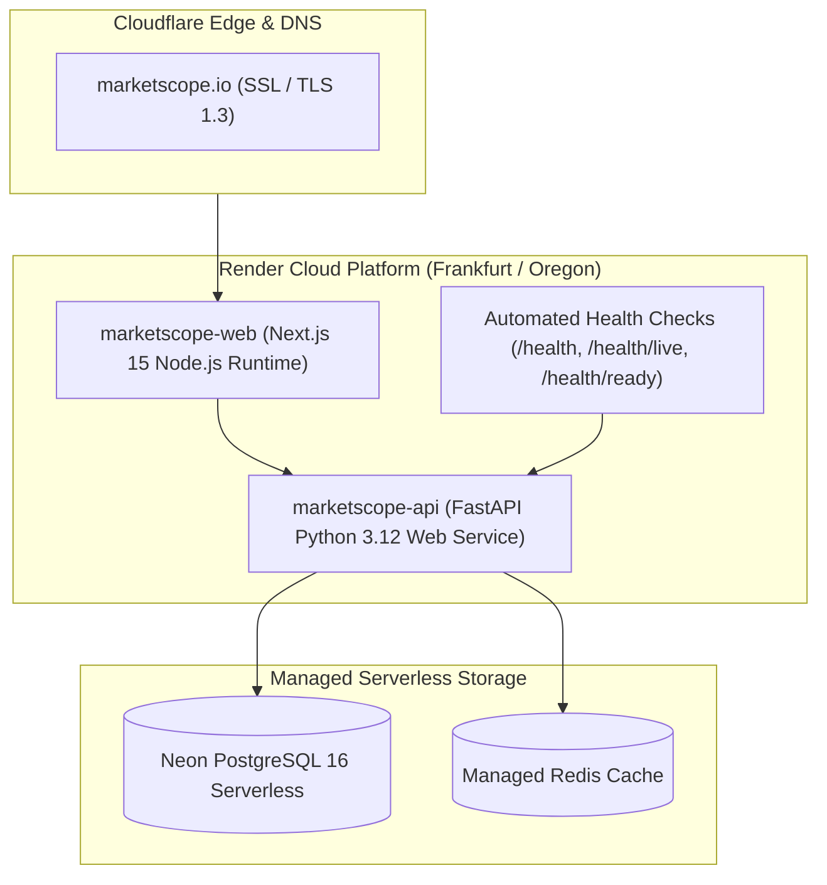

# Deployment Architecture Specification
**Platform:** MarketScope.io  
**Cloud Infrastructure:** Render PaaS + Neon Serverless PostgreSQL 16  

## 1. Production Deployment Topology

## 2. Health Monitoring & Recovery Runbooks
- **Liveness Endpoint (`/health/live`)**: Confirms process responsiveness.
- **Readiness Endpoint (`/health/ready`)**: Validates database connection with latency measurement (`SELECT 1`). Returns `status: ready` or `status: degraded`.
- **Zero-Downtime Rollbacks**: Stateless container images allow instant 1-click rollback on Render upon deployment failure.
