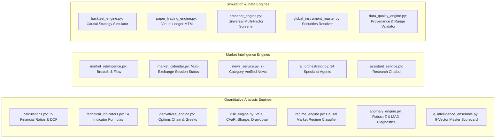

# Engine Architecture Specification
**Platform:** MarketScope.io  

## 1. Engine Directory & Responsibilities
The platform operates 17 analytical, quantitative, intelligence, and data management engines:

## 2. Execution Contracts & Guarantees
- Every analytical engine provides typed Pydantic input and output schemas.
- Calculations execute with deterministic reproducibility.
- Zero future-lookahead bias is strictly maintained across regime detection, technical indicators, and backtesting.
