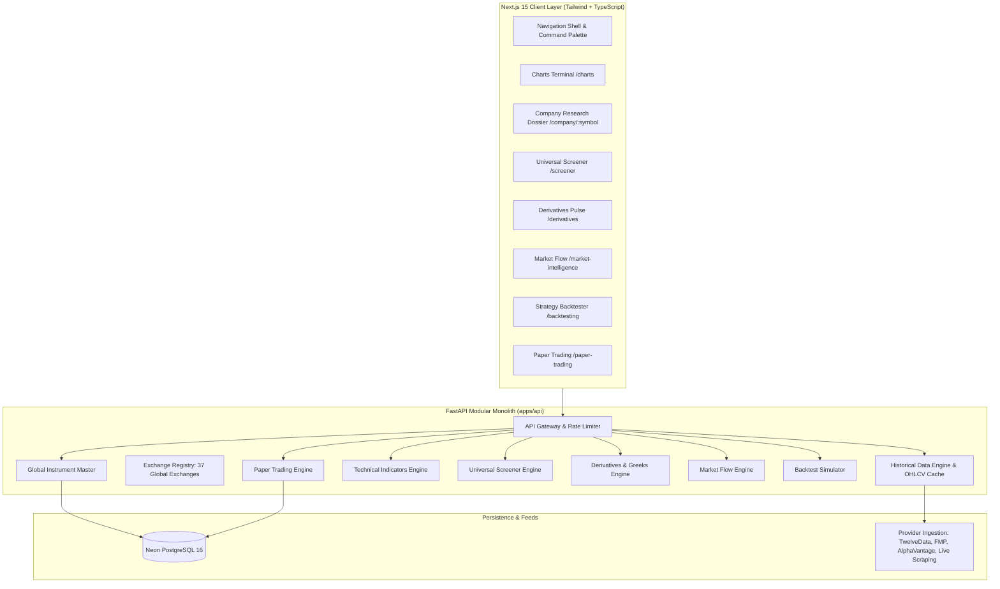

# MarketScope.io — Product Architecture & Monolith Design
## Unified Multi-Exchange Financial Intelligence & Research Monolith

---

## 1. System Vision & Architecture Principles

MarketScope.io provides a research-only financial platform that merges the interactive charting excellence of TradingView, the navigation speed of Zerodha Kite, the fundamental research depth of Tickertape, and the quantitative options intelligence of VerquoAI.

### Key Architectural Pillars:
1. **Decoupled Instrument Master**: `CompanyLegalEntity` (registered corporate entities, filings, financial statements) is strictly separated from `GlobalInstrument` (exchange-specific ticker, currency, trading hours, order-routing metadata). This correctly handles multi-share classes (e.g. Tata Motors Ordinary vs DVR, Alphabet Class A vs C) and dual listings (ADRs).
2. **Canonical OHLCV Pipeline**: Single uniform data model for daily, intraday, and historical timeframes with explicit provenance status (`LIVE`, `DELAYED_15M`, `CALIBRATED_EOD`, `LICENCE_REQUIRED`).
3. **Deterministic Math Engine**: All indicators, Greeks, and backtest results are calculated server-side or on dedicated web workers using verified mathematical algorithms (Wilder's Smoothing, Black-Scholes PDE, Mark-to-Market accounting).
4. **Research-Only & Non-Custodial**: MarketScope.io contains no real broker order execution, money custody, or algorithmic trade dispatching.

---

## 2. Monolith Component Topology

---

## 3. Security, Privacy & DPDP Compliance
- **Authentication**: Modern token-based authentication via Clerk with session synchronization.
- **Data Protection**: Full support for India's Digital Personal Data Protection (DPDP) Act with verified endpoints:
  - `POST /api/v1/workspace/dpdp/export` (Encrypted data export)
  - `POST /api/v1/workspace/dpdp/purge` (Right to be forgotten with complete erasure)
- **Deployment Hardening**: Render-ready containerization binding to dynamic `$PORT` with gunicorn/uvicorn concurrency and connection pooling.
