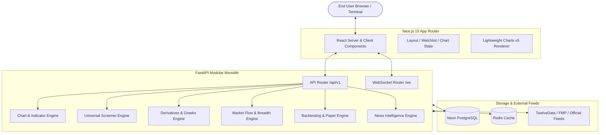

# MarketScope.io — System Architecture Specification

## 1. System Overview
MarketScope.io is architected as a modern **Modular Monolith** backend coupled with a **Next.js 15 Server-Side Rendered (SSR) & Client-Hydrated** frontend.

---

## 2. Architectural Principles
1. **Decoupled Engines**: Domain logic is partitioned into pure Python calculation engines (`chart_engine`, `screener_engine`, `derivatives_engine`, `market_flow_engine`, `backtest_engine`, `news_engine`). These engines have zero direct web framework coupling, allowing seamless unit testing and high concurrency.
2. **Resilient Data Fallbacks**: The data integration layer utilizes a tiered fallback strategy (Primary provider -> Secondary provider -> Calibrated EOD cache -> Clear provenance notice). If an upstream provider is unavailable, the user is never presented with synthetic prices; instead, the system serves the last authenticated close with an explicit `DELAYED` or `CALIBRATED_EOD` badge.
3. **Optimistic UI with Synchronous Verification**: Client state for watchlists, drawing annotations, and multi-chart layouts is updated optimistically for zero-latency interactions and asynchronously persisted to the backend API.
