# System Architecture Specification
**Platform:** MarketScope.io  
**Architecture Style:** Enterprise Modular Monolith with Frontend/Backend Decoupling  
**Version:** 2.0.0-PROD  

---

## 1. High-Level System Architecture Diagram

```mermaid
graph TD
    ClientBrowser([Client Web Browser / Mobile Device])

    subgraph Presentation_Layer ["Presentation & Experience Layer (Next.js 15.5)"]
        AppRouter["Next.js App Router (39 Routes)"]
        LWCharts["Lightweight Charts v5.3.0 Engine"]
        AssistantUI["Floating AI Assistant Widget"]
        ClerkAuth["Clerk OIDC Client"]
    end

    subgraph API_Gateway ["API Gateway & Security Layer (FastAPI 0.115)"]
        SecHeaders["SecurityHeadersMiddleware (CSP, HSTS, X-Frame)"]
        CorrId["CorrelationIdMiddleware (X-Request-ID)"]
        CORSMiddleware["CORS Policy Enforcement"]
        RateLimiter["Token-Bucket Rate Limiter"]
    end

    subgraph Analytical_Engines ["Analytical & Quantitative Engines"]
        QIntEnsemble["Q-Intelligence Multi-Factor Ensemble"]
        RiskEngine["Quantitative Risk Engine (VaR, Sharpe, Beta)"]
        RegimeEngine["Market Regime Detection Engine"]
        AnomalyEngine["Robust Z-Score & MAD Anomaly Engine"]
        FundamentalEngine["Fundamental & Valuation Engine"]
        DerivativesEngine["Black-Scholes Greeks & Options Engine"]
        TechnicalEngine["14-Formula Technical Indicator Engine"]
        CalendarEngine["Global Market Calendar & Hours Engine"]
        NewsEngine["Worldwide News Intelligence Engine"]
    end

    subgraph AI_Infrastructure ["Multi-Agent AI Infrastructure"]
        AIOrch["Central AI Orchestrator"]
        SpecialistAgents["14 Specialist Financial Research Agents"]
        PIISanitizer["Prompt Injection Defense & PII Redactor"]
        GroundedRAG["Grounded RAG with Traceable Citations"]
    end

    subgraph Data_Storage ["Persistence & External Providers"]
        Postgres[(Neon PostgreSQL 16 DB)]
        RedisCache[(Redis Distributed Cache / Event Bus)]
        RegFilings["Primary Exchange & Regulatory Filings (NSE, BSE, SEC, RBI)"]
        CommercialAPIs["Commercial Feeds (TwelveData, FMP)"]
    end

    ClientBrowser <--> Presentation_Layer
    Presentation_Layer <--> API_Gateway
    API_Gateway --> Analytical_Engines
    API_Gateway --> AI_Infrastructure
    AI_Infrastructure --> Analytical_Engines
    Analytical_Engines --> Data_Storage
```

## 2. Layer Responsibilities & Isolation Principles
- **No Direct Database Access from Frontend**: All database operations occur through authenticated FastAPI backend endpoints.
- **Deterministic Math Isolation**: Financial ratios, option Greeks, and technical indicators are strictly evaluated via pure Python/NumPy analytical engines, never outsourced to stochastic LLM estimations.
- **Strictly Non-Custodial**: Real-money order routing and brokerage execution are outside system boundaries.
