# Project Architecture Audit
**Platform:** MarketScope.io  
**Evaluation Date:** November 2026  
**Auditor:** Principal Software & Enterprise Systems Architect  
**Scope:** Complete repository inspection (Frontend, Backend, Database, Analytical Engines, AI, Security, Licensing)

---

## 1. Executive Architecture Summary
MarketScope.io is structured as a **hybrid modular monolith** with a modern frontend-backend separation:
- **Frontend**: Next.js 15.5.29 (App Router) with React 19.0.0, Tailwind CSS, TypeScript, and Lightweight Charts v5.3.0. Prerenders 38 static and dynamic routes.
- **Backend**: FastAPI 0.115.0 on Python 3.12, utilizing SQLAlchemy 2.0 with Psycopg 3 dialect, Pydantic v2 schemas, and pure analytical calculation engines.
- **Database**: PostgreSQL 16 (Neon Serverless compatibility with connection pooling and SSL enforcement).
- **Identity**: Clerk Managed OIDC with JWT token exchange and role mapping.
- **Intelligence**: Grounded RAG with multi-model fallback (Groq, Gemini, OpenRouter, Deterministic Engine) and context-aware research chatbot.

---

## 2. Logical Layer Audit

| Layer | Implementation Component | Implementation Status | Quality Rating | Key Observations / Findings |
|---|---|---|---|---|
| **1. Presentation & Experience** | `apps/web/src/app` (38 routes), `apps/web/src/components` (24 components) | `IMPLEMENTED` / `VALIDATED` | **A-** | Fluid Next.js 15 App Router architecture. Dark/Light theme support, responsive canvas charting, floating research assistant. |
| **2. API Gateway & BFF** | `apps/api/app/main.py`, `CORS`, Rate Limiter | `IMPLEMENTED` / `VALIDATED` | **B+** | Prefix-routed routers (`/api/v1`). CORS configured for production and local environments. Needs request correlation IDs and API version headering. |
| **3. Identity & Access (IAM)** | Clerk Next.js SDK, `workspace_memberships` in SQL | `PARTIALLY_IMPLEMENTED` | **B** | Client-side Clerk integration is operational. Server-side RBAC and fine-grained resource-level permission checks need central enforcement. |
| **4. Workflow Orchestration** | FastAPI async handlers, in-memory state | `PARTIALLY_IMPLEMENTED` | **B-** | Direct synchronous/async request handling. Lacks distributed durable task queue (e.g. Celery/Arq with Redis) for heavy background calculations. |
| **5. AI & Agent Orchestration** | `assistant_service.py`, `ai_synthesis.py` | `PARTIALLY_IMPLEMENTED` | **B** | Grounded RAG with verifiable citations is functional. Needs unified multi-agent orchestrator managing the 14 specialist financial agents. |
| **6. Quantitative & Intelligence** | `calculations.py`, `technical_indicators.py`, `derivatives_engine.py` | `IMPLEMENTED` / `VALIDATED` | **A** | Pure NumPy/mathematical implementations of 15 financial ratios, Black-Scholes Greeks, Max Pain, and 14 technical indicators. Needs ensemble Q-Intelligence engine. |
| **7. Market Data & News** | `market_data_service.py`, `market_calendar.py`, `news_routes.py` | `IMPLEMENTED` / `VALIDATED` | **A** | Authoritative 9-exchange calendar engine, 7-category news classifier with publisher verification and cryptographic hash lineage. |
| **8. Domain Services** | `app/domain` models, schemas, and canonical types | `IMPLEMENTED` / `VALIDATED` | **A-** | Strongly typed Pydantic models for prices, charts, news, calendar, and assistant. |
| **9. Persistence & Caching** | PostgreSQL 16, SQLAlchemy 2.0, In-memory cache | `PARTIALLY_IMPLEMENTED` | **B** | Neon Postgres pooling configured. Redis URL configured in settings but distributed caching is currently fallback in-memory. |
| **10. Security & Governance** | Rate limiting, CORS, cryptographic snapshots, audit events | `PARTIALLY_IMPLEMENTED` | **B+** | Tamper-evident HMAC-SHA256 snapshot verification in place. Needs enhanced security headers, PII redaction, and strict AI tool allowlists. |
| **11. Observability & Infra** | `/health`, `/health/live`, `/health/ready`, Sentry integration | `IMPLEMENTED` / `VALIDATED` | **B+** | Three-tier health checks verified. Needs structured JSON logging and OpenTelemetry tracing. |

---

## 3. Domain Boundary Analysis

```mermaid
graph TD
    subgraph Presentation ["Presentation Layer (Next.js 15)"]
        UI_Home["/ (Home & Status)"]
        UI_Calendar["/calendar (Market Calendar)"]
        UI_News["/news (Verified News)"]
        UI_Charts["/charts (TradingView Charts)"]
        UI_Company["/company/[symbol] (Dossier)"]
        UI_Screener["/screener (Quant Screener)"]
        UI_Assistant["FloatingAssistantChatbot"]
    end

    subgraph API_Gateway ["API Gateway Layer (FastAPI 0.115)"]
        MainApp["app.main:app"]
        RateLimit["RateLimiter Middleware"]
        AuthMiddleware["IAM & Auth Verification"]
    end

    subgraph Domain_Engines ["Analytical & Intelligence Engines"]
        CalendarEngine["Market Calendar & Status Engine"]
        NewsEngine["Global News Intelligence Engine"]
        AssistantEngine["Floating AI Research Assistant"]
        QuantEngine["Fundamental & Valuation Engine"]
        DerivativesEngine["Derivatives & Greeks Engine"]
        TechnicalEngine["Technical Indicators Engine"]
        BacktestEngine["Backtest & Paper Trading Engine"]
    end

    subgraph Data_Layer ["Storage & External Providers"]
        Postgres[(PostgreSQL 16 Database)]
        RedisCache[(Redis Distributed Cache)]
        PrimaryProviders["Official Regulatory Filings & Market Feeds"]
    end

    Presentation --> API_Gateway
    API_Gateway --> Domain_Engines
    Domain_Engines --> Data_Layer
```

---

## 4. Architectural Strengths & Structural Deficiencies

### Strengths
1. **Strictly Non-Custodial Stance**: Clear legal positioning with zero simulated brokerage execution or custody liability.
2. **Deterministic Financial Math**: Indicator formulas and financial ratios are calculated directly using NumPy and audited mathematical formulas, never delegated to generative LLM approximations.
3. **Traceable News Lineage**: News items and assistant citations are cryptographically hashed and linked to official regulatory sources (NSE, BSE, SEBI, RBI, SEC).
4. **Authoritative Calendar Architecture**: Accurately differentiates exchange trading holidays from banking settlements (NI Act Section 25) and commodity dual sessions (MCX).

### Deficiencies & Recommended Upgrades
1. **Multi-Agent Orchestration**: Agent logic is currently embedded in `assistant_service.py` and `ai_synthesis.py`. Needs a modular `AI Orchestrator` with 14 isolated specialist agents.
2. **Quantitative Ensemble**: Needs an integrated `MarketScope Q-Intelligence Engine` combining fundamentals, growth, valuation, technicals, risk, news sentiment, market regimes, and anomalies into an explainable ensemble.
3. **Risk & Regime Modules**: Formalize separate `Risk Analysis Engine` (VaR, CVaR, Sortino, Calmar) and `Market Regime Detection Engine` (filtered trend/volatility probabilities).
4. **Distributed Caching & Queues**: Wire Redis into Celery/Arq worker pipelines for heavy background analysis and data ingestion.
