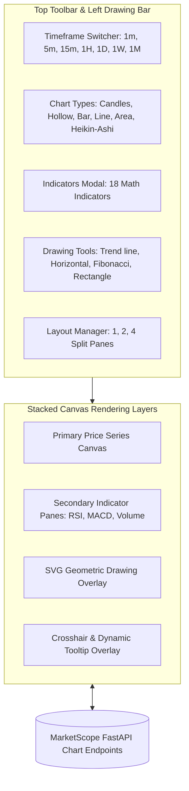

# MarketScope.io — Chart Engine Architecture
## High-Performance Interactive Financial Canvas Terminal

---

## 1. Overview & Rendering Model

MarketScope.io's charting experience combines TradingView-level interactivity with Zerodha Kite's streamlined ergonomics:
- **Canvas Rendering**: Powered by TradingView's Lightweight Charts library, ensuring 60fps hardware-accelerated pan, zoom, and time-scale scrubbing.
- **Dedicated Route**: Standalone full-screen terminal at `/charts` with multi-chart layout splitting (Single, 2-Horizontal, 2-Vertical, 4-Grid), symbol comparison, and persistent user workspaces.
- **Integrated Detail Route**: Embedded interactive chart on `/company/[symbol]` with dynamic timeframe switching (`1m` to `1Y`), volume sub-panels, and cross-listing switcher.

---

## 2. Multi-Layer Canvas Architecture

---

## 3. Supported Chart Types
1. **Candlestick**: Standard Japanese candles with colored bodies (Emerald Bullish, Rose Bearish).
2. **Hollow Candles**: Open vs Close directional bodies with unfilled interiors for close > open.
3. **Bar (OHLC)**: Classical tick bars with left open tick and right close tick.
4. **Line**: Clean closing price line series.
5. **Area**: Gradient filled area under closing price.
6. **Baseline**: Dual-color shaded performance deviation from user-selected baseline.
7. **Heikin-Ashi**: Smoothed trend candles derived from synthetic average price relationships:
   - $HA\_Close = (Open + High + Low + Close) / 4$
   - $HA\_Open = (HA\_Open_{prev} + HA\_Close_{prev}) / 2$
   - $HA\_High = \max(High, HA\_Open, HA\_Close)$
   - $HA\_Low = \min(Low, HA\_Open, HA\_Close)$
