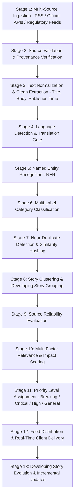

# News Intelligence Algorithm & Processing Pipeline
**Document Reference:** `docs/design/NEWS_INTELLIGENCE_ALGORITHM.md`  
**Version:** 2.0 (Complete System Redesign)  
**Date:** 21 November 2026  
**Auditor:** Senior Product Designer, UI/UX Architect, Financial Product Specialist  

---

## 1. Executive Summary

The **MarketScope News Intelligence Engine** is a core competitive differentiator. It is not a passive RSS reader or a basic blog. It is an algorithmic pipeline designed to ingest, validate, classify, deduplicate, score, and evaluate the financial market impact of news developments worldwide.

Its ultimate goal is to answer for any financial event:
**"What happened, how reliable is the reporting, which markets and companies are affected, and what are the direct economic transmission channels?"**

---

## 2. End-to-End News Processing Pipeline

The ingestion and analysis pipeline executes across 13 deterministic stages:



### Stage Details:
1. **Stage 1 (Ingestion):** Ingest articles from authorized publisher RSS feeds, official exchange announcements (NSE/BSE filings), government portals (PIB, RBI, Ministry of Finance), and licensed news APIs.
2. **Stage 2 (Validation):** Verify publisher credentials, canonical source URLs, and original publication timestamps. Strip tracking tags and malformed query strings.
3. **Stage 3 (Extraction):** Parse headline, summary, full body text (where licensed), author, publisher name, publication time, and language.
4. **Stage 4 (Language):** Enforce language identification; route non-English articles through approved translation or flag for language filtering.
5. **Stage 5 (Entity Recognition):** Identify listed companies, ticker symbols, executives, government officials, central banks, commodities, currencies, and countries.
6. **Stage 6 (Classification):** Tag each article with one or more operational categories (e.g., Monetary Policy, Earnings, Geopolitics, Supply Chain).
7. **Stage 7 (Deduplication):** Compute MinHash / TF-IDF cosine similarity vectors across title and body text to identify duplicate or near-duplicate wire reports.
8. **Stage 8 (Clustering):** Group reports covering the same underlying event under a unified **Developing Story Cluster**.
9. **Stage 9 (Source Reliability):** Assign a publisher trust score based on established tiering (Tier 1: Regulatory / Official Wires; Tier 2: Established Financial Press; Tier 3: General Media).
10. **Stage 10 (Relevance Scoring):** Compute the composite **Market Relevance & Impact Score (0–100)** using the weighted formula.
11. **Stage 11 (Priority Assignment):** Categorize into priority tiers: `Breaking`, `Critical`, `High Importance`, `Medium Importance`, `General`, or `Low Relevance`.
12. **Stage 12 (Distribution):** Index into the search engine, distribute to relevant category feeds, and stream to connected WebSocket / SSE clients.
13. **Stage 13 (Evolution):** As follow-up reporting arrives, update the parent story cluster without cluttering the user feed with redundant duplicates.

---

## 3. Entity Recognition & Canonical Resolution

Entity extraction uses deterministic rule sets, canonical dictionaries, and disambiguation filters to map plain-text references to verified database records:

### 3.1 Entity Categories
- **Companies & Tickers:** Mapped directly to ISIN and exchange tickers (e.g. "Reliance", "RIL", "Reliance Industries" -> `NSE:RELIANCE`).
- **People & Executives:** Mapped to role and organization (e.g. "Shaktikanta Das" -> Governor, Reserve Bank of India; "Jerome Powell" -> Chair, Federal Reserve).
- **Public & Regulatory Institutions:** SEBI, RBI, Federal Reserve, ECB, Bank of Japan, Ministry of Finance, MCA.
- **Indices & Commodities:** NIFTY 50, SENSEX, NASDAQ, S&P 500, Brent Crude, Gold, Natural Gas, USD/INR.
- **Sectors & Industries:** Banking, Information Technology, Oil & Gas, Automotive, Pharmaceuticals, FMCG, Telecom.

### 3.2 Disambiguation Rules
- Company names that match ordinary English words (e.g., "Target", "Next", "Gap", "Focus") require financial or stock context (e.g., presence of "shares", "Q3 profit", "revenue", "CEO", or dollar/rupee signs) before entity matching is triggered.

---

## 4. News Relevance & Potential Impact Scoring Algorithm

The **Relevance & Impact Score ($S_{\text{news}}$)** is a deterministic 0–100 rating computed from seven weighted dimensions:

$$\begin{aligned}
S_{\text{news}} = & \; (0.25 \times R_{\text{market}}) + (0.20 \times I_{\text{impact}}) + (0.15 \times C_{\text{source}}) \\
& + (0.15 \times E_{\text{entity}}) + (0.10 \times T_{\text{recency}}) + (0.10 \times G_{\text{geo}}) \\
& + (0.05 \times K_{\text{corroboration}})
\end{aligned}$$

### 4.1 Weight Breakdown & Factor Definitions

| Dimension | Weight | Definition & Evaluation Criteria |
| :--- | :---: | :--- |
| **Market Relevance ($R_{\text{market}}$)** | **25%** | Direct connection to capital markets, asset prices, interest rates, earnings surprises, or liquidity conditions. |
| **Potential Impact ($I_{\text{impact}}$)** | **20%** | Materiality of the development: macro systemic shocks (rate hikes, war) score 90–100; single-firm product updates score 40–60. |
| **Source Reliability ($C_{\text{source}}$)** | **15%** | Tier 1 (Official filings, Central banks, PIB, SEBI): 100; Tier 2 (Reuters, Bloomberg, Mint, Business Standard): 85; Tier 3 (General press): 60. |
| **Entity Relevance ($E_{\text{entity}}$)** | **15%** | Prominence of identified entities: mega-cap index constituents (Reliance, Apple, NIFTY 50) receive higher weighting than micro-caps. |
| **Recency ($T_{\text{recency}}$)** | **10%** | Time decay: 100 for < 1 hour old; 80 for 1–4 hours; 50 for 4–12 hours; 25 for > 24 hours. |
| **Geographic Relevance ($G_{\text{geo}}$)** | **10%** | Relevance to the Indian financial ecosystem or major trading partners (US, EU, Middle East, China). |
| **Corroboration ($K_{\text{corroboration}}$)** | **5%** | Number of independent, verified publishers reporting the event (1 source = 50, 2 sources = 80, 3+ sources = 100). |
| **Total** | **100%** | **Final normalized score between 0 and 100.** |

---

## 5. News Priority Tiers

Based on the composite score and materiality flags, each story is assigned an unambiguous priority level:

| Priority Level | Score Range | Criteria & Visual Badge | Client Placement |
| :--- | :---: | :--- | :--- |
| **Breaking** | 88 – 100 + Time < 30m | Unexpected systemic events (emergency rate decisions, war, major exchange halt). Visual: Crimson Red pulsating badge. | Top marquee banner across all pages. |
| **Critical** | 78 – 87 | High-materiality scheduled events (RBI policy announcement, Union Budget, US CPI). Visual: Amber badge. | Featured hero slot on `/news` and `/dashboard`. |
| **High Importance** | 65 – 77 | Major corporate earnings, large M&A deals, significant sector regulatory changes. Visual: Electric Blue badge. | Primary feed top rank. |
| **Medium Importance**| 45 – 64 | Routine quarterly updates, executive appointments, industry trade data. Visual: Slate Gray badge. | Standard categorical feed. |
| **General** | 25 – 44 | General market commentary, sector opinions, educational analyses. Visual: Subtle border badge. | Searchable archive. |
| **Low Relevance** | < 25 | Promotional releases, speculative opinion pieces, noise. Visual: Filtered by default. | Excluded from main feeds. |

---

## 6. Deduplication & Story Clustering

When multiple publishers report the same event within a short timeframe (e.g. "RBI Keeps Repo Rate at 6.50%"), publishing every article separately produces cognitive clutter.

### 6.1 Clustering Logic
1. **Windowing:** Group articles published within a sliding 6-hour window.
2. **Entity & Keyword Matching:** Compute intersection over entities ($E_1 \cap E_2$) and TF-IDF title cosine similarity. If similarity $\ge 0.72$, articles are merged into a **Developing Story Cluster**.
3. **Primary Lead Selection:** The earliest verified report from the highest-tier publisher becomes the cluster lead headline.
4. **Source Attribution:** The cluster card displays:
   - Primary headline and summary.
   - Initial publication time and latest update time.
   - List of corroborating publishers: *"Reported by Reuters (10:02 AM), Mint (10:05 AM), Business Standard (10:11 AM)"*.

---

## 7. Market Impact Modeling & Transmission Channels

For stories with high potential impact ($I_{\text{impact}} \ge 70$), the algorithm generates a structured **Market Impact Assessment Card**:

### 7.1 Structure of an Impact Card
- **Primary Event:** Clear 1-sentence statement of fact.
- **Directly Affected Assets:** Specific ticker symbols, commodities, and currency pairs.
- **Affected Sectors:** Specific industries facing cost pressures or tailwinds.
- **Transmission Channels:** Step-by-step causal flow grounded in macroeconomic and corporate finance principles.
- **Distinction of Evidence:** Confirmed factual impacts are styled with solid borders; possible secondary implications are styled with dashed borders and explicit uncertainty tags.

### 7.2 Example: Middle East Oil Supply Disruption
```
Event: Geopolitical escalation halts regional crude output by 1.2M bpd.
[Confirmed Affected Assets]
  - Brent Crude Futures ($BRENT) -> Upward price pressure
  - WTI Crude ($WTI) -> Upward price pressure
  - Indian Rupee ($USDINR) -> Depreciation pressure due to widened trade deficit
[Transmission Channels]
  Channel 1: Input Cost Spike -> Oil Marketing Companies (IOC, BPCL, HPCL) margin contraction
  Channel 2: Transportation & Logistics -> Aviation (IndiGo) jet fuel cost surge
  Channel 3: Macro Inflation -> Higher transportation costs feed into domestic CPI
[Source Citations]
  - Verified across 3 reports (Reuters, Bloomberg, ANI)
```

---

## 8. Compliance & Ethical Boundaries

1. **No Proprietary Full-Text Reproduction:** Ingested articles respect publisher licensing, copyright, and robots.txt. The platform presents structured metadata, executive summaries, entity tags, and direct outbound links to original publisher articles.
2. **No Guaranteed Predictions:** Market impact analysis describes potential economic transmission channels and historical correlations; it explicitly disclaims guaranteed price forecasts.
3. **Input Sanitization:** Ingested text is rigorously sanitized to prevent prompt-injection attacks, cross-site scripting (XSS), or poisoned financial data.
