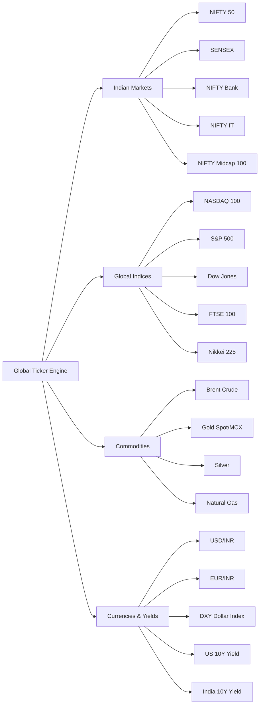
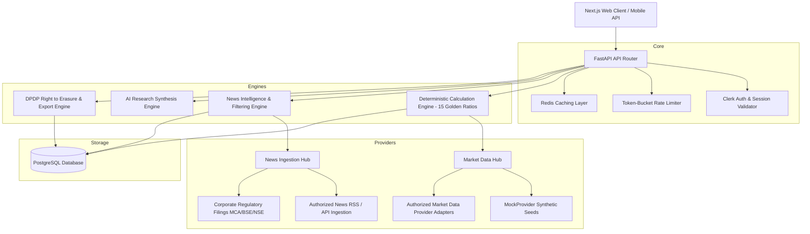

# Redesign Product & UX Architecture — MarketScope.io
**Document Reference:** `docs/design/REDESIGN_PRODUCT_ARCHITECTURE.md`  
**Version:** 2.0 (Complete System Redesign)  
**Date:** 21 November 2026  
**Status:** Architecture Blueprint  

---

## 1. Architectural Vision & Principles

MarketScope.io is architected as an **evidence-first financial research and market intelligence workspace**. Unlike trading platforms designed for transaction frequency, or generalist financial portals cluttered with advertising, MarketScope is engineered around three foundational pillars:

1. **Market Awareness (TradingView Inspiration):** Real-time multi-asset continuous ticker, global market breadth, sector performance heatmaps, and comprehensive index coverage spanning India, the US, Europe, Asia, commodities, currencies, and sovereign debt.
2. **Fundamental Truth & Discovery (Tickertape Inspiration):** Approachable company discovery, 5-pillar fundamental health scorecards, pre-built quantitative screeners, peer comparison matrices, and clean canonical financial statement exploration.
3. **Decision Intelligence & Traceability (VerquoAI & MarketScope Core):** Multi-perspective thesis stress-testing, downside risk exposure mapping, interactive Evidence Drawers linking every metric directly to regulatory filings (MCA, BSE, NSE, SEC), and immutable cryptographic research snapshots.

---

## 2. Information Architecture & Navigation Hierarchy

The redesigned application adopts a scalable, unified navigation system structured into **9 core operational sections** accessible through a responsive navigation shell (desktop collapsible sidebar + mobile drawer):

```mermaid
flowchart TD
    Shell[Application Navigation Shell] --> Ticker[Global Multi-Asset Continuous Ticker]
    
    Shell --> Sec1[1. Dashboard / Overview]
    Shell --> Sec2[2. Markets Hub]
    Shell --> Sec3[3. Stocks Discovery]
    Shell --> Sec4[4. News Intelligence Centre]
    Shell --> Sec5[5. Fundamental Screeners]
    Shell --> Sec6[6. Companies Directory]
    Shell --> Sec7[7. Research & Dossiers]
    Shell --> Sec8[8. Watchlists & Portfolios]
    Shell --> Sec9[9. Calendar & Events]
    Shell --> Sec10[Settings & DPDP Governance]

    Sec1 --> D1[Market Pulse & Breadth]
    Sec1 --> D2[Top Companies Indian + Global]
    Sec1 --> D3[Market Movers]
    Sec1 --> D4[Breaking News Wire]

    Sec2 --> M1[Indian Equities NSE/BSE]
    Sec2 --> M2[Global Indices US/EU/Asia]
    Sec2 --> M3[Commodities Metals & Energy]
    Sec2 --> M4[Currencies & Sovereign Yields]
    Sec2 --> M5[Interactive Sector Heatmaps]

    Sec4 --> N1[Breaking & Developing Stories]
    Sec4 --> N2[Category Feeds Policy/Earnings/Geopolitics]
    Sec4 --> N3[Universal News Search]
    Sec4 --> N4[Market Impact Transmission Models]
```



### 2.1 Route Map

| Primary Section | Route Path | Core Functional Capabilities |
| :--- | :--- | :--- |
| **Dashboard** | `/` or `/dashboard` | Multi-asset market pulse, top companies, market movers, breaking news wire, active watchlist summary. |
| **Markets** | `/markets` | In-depth domestic & international index tracking, commodities, forex pairs, sovereign yields, advance/decline breadth, sector heatmaps. |
| **Stocks** | `/stocks` | Equity discovery directory, trending stocks, gainers, losers, volume shockers, 52-week extremes across NSE, BSE, and US markets. |
| **News Intelligence** | `/news` | Curated market intelligence wire, category filters, multi-entity search, story clustering, and market-impact transmission cards. |
| **News Detail** | `/news/[id]` | Dedicated story view with publisher citations, corroborated sources, entity tags, and transmission channel breakdown. |
| **Screeners** | `/screener` | Quantitative fundamental screener with pre-built thematic presets (Compounders, Low Debt, Dividend, Value) and custom sliders. |
| **Companies** | `/companies` | Industry-classified company directory, sector breakdowns, and market cap tiering. |
| **Research (Company)**| `/company/[symbol]` | Full company dossier: price chart, 5-pillar scorecard, financial statements, 15 golden ratios, Evidence Drawer, notes, and AI synthesis. |
| **Compare** | `/compare` | Multi-company peer comparison matrix with valuation radars and golden ratio benchmarking. |
| **Watchlists** | `/watchlists` | Multi-tenant user watchlists with real-time price changes, sector weights, and contextual news alerts. |
| **Calendar** | `/calendar` | Macroeconomic events (RBI, Fed, CPI, GDP) + Corporate earnings calendar + Corporate actions (dividends, splits). |
| **Workspace & Privacy**| `/workspace` | DPDP Act 2023 compliance dashboard, data portability export (JSON), and irreversible cascade purge controls. |
| **Settings** | `/settings` | User display preferences, default exchange, notification toggles, and security settings. |

---

## 3. Global Multi-Asset Ticker Architecture

The **Global Market Ticker** is a permanent, high-visibility component positioned directly below the primary navigation header across all authenticated views.

### 3.1 Instrument Universe



### 3.2 Ticker Technical Specifications
- **Display Properties:** Continuous horizontal marquee ribbon with hardware-accelerated CSS animations (`translateX`).
- **Interaction Model:** Smooth auto-scroll; instant pause-on-hover; 1-click navigation to instrument research dossier.
- **Card Content:** Instrument symbol, exchange badge, current price (formatted in local currency or points), absolute change, percentage change pill (+Green / -Red), live/delayed status indicator, and market open/closed status indicator.
- **Mobile Adaptation:** Collapses from marquee to touch-draggable horizontal carousel with overflow-x scrolling.

---

## 4. Frontend Component Architecture

The frontend is modularized into cleanly decoupled, reusable component layers in `apps/web/src/components/`:

```
apps/web/src/components/
├── BrandLogo.tsx               # Official emblem, horizontal banner, and inline typography
├── NavigationShell.tsx         # Responsive sidebar, topbar, mobile drawer, and breadcrumbs
├── MarketTicker.tsx            # Global continuous multi-asset ticker system
├── MarketOverview/             # Dashboard modules
│   ├── MarketSnapshotCard.tsx  # Macro summary and breadth gauges
│   ├── TopCompaniesGrid.tsx    # Indian & Global corporate leaders
│   ├── MarketMoversTabs.tsx    # Gainers, Losers, Most Active, 52W High/Low
│   └── MarketHeatmap.tsx       # Interactive sector tree-map visualization
├── NewsIntelligence/           # News Intelligence Centre components
│   ├── NewsTickerBar.tsx       # Breaking news alert marquee
│   ├── NewsCard.tsx            # Article card with entity tags & relevance score
│   ├── NewsFilters.tsx         # Category, country, priority, and date filters
│   ├── NewsImpactCard.tsx      # Market transmission channels & affected assets
│   └── StoryClusterGroup.tsx   # Deduplicated stories with multi-source publisher list
├── Research/                   # Company deep-dive modules
│   ├── CompanyScorecard.tsx    # 5-pillar fundamental health breakdown
│   ├── InteractiveChart.tsx    # Lightweight financial price & volume history
│   ├── FinancialStatementsExplorer.tsx # Tabular Income, Balance Sheet, Cash Flow
│   ├── EvidenceDrawer.tsx      # Raw filing citation & formula verification
│   └── AISynthesisPanel.tsx    # Multi-perspective scenario stress-testing
└── Common/                     # Shared UI primitives
    ├── Badge.tsx, Modal.tsx, Tabs.tsx, Tooltip.tsx, DataStatusTag.tsx
```

---

## 5. Backend Service Architecture & Data Flow

The FastAPI backend (`apps/api/app/`) separates analytical engines, data providers, and API endpoints into discrete modules:



---

## 6. Security, Compliance & Governance Baseline

1. **SEBI Compliance Boundary:** Strictly read-only research intelligence. No trade execution, brokerage order routing, portfolio management, or automated Buy/Sell signals. Every analytical view contains explicit statutory research disclaimers.
2. **DPDP Act 2023 Readiness:** Section 11/12 compliant right to data portability (complete JSON package export) and right to erasure (irreversible cascade deletion of user notes, snapshots, and watchlists).
3. **Data Provenance Integrity:** Every metric displays its calculation period, currency, reporting basis, formula expression, and direct filing reference via the Evidence Drawer. Synthetic development data is always explicitly labeled.
