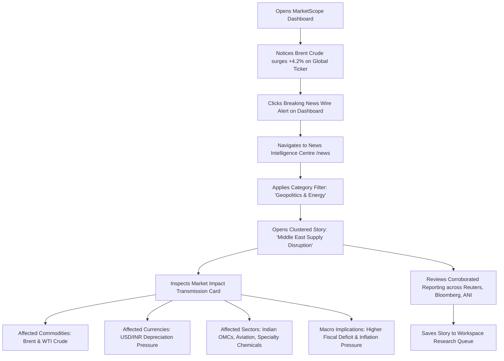
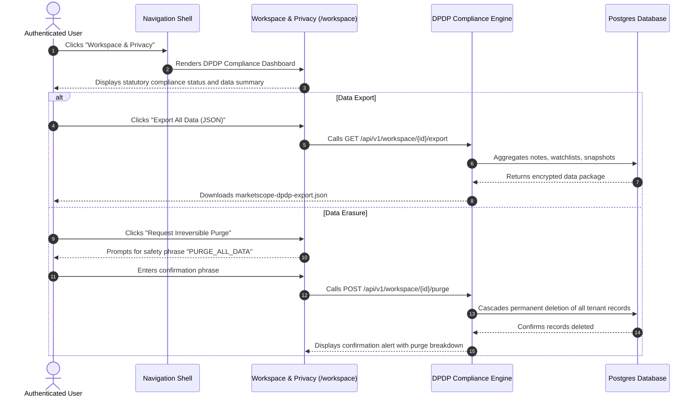

# Redesign User Journeys — MarketScope.io
**Document Reference:** `docs/design/REDESIGN_USER_JOURNEYS.md`  
**Version:** 2.0 (Complete System Redesign)  
**Date:** 21 November 2026  
**Auditor:** Senior Product Designer & UI/UX Architect  

---

## 1. Persona Definitions

To validate the redesigned user experience and information architecture, four distinct user personas have been formulated:

| Persona | Role & Background | Primary Objective | Key Pain Point in Current Platforms |
| :--- | :--- | :--- | :--- |
| **Arjun Mehta** | Senior Equity Research Analyst (Institutional Fund) | Inspect deterministic company financials, verify formula derivations against regulatory filings, and create audit-proof snapshots. | Existing retail tools provide unverified numbers without raw filing quotes or mathematical derivations. |
| **Priya Sharma** | VP of Corporate Strategy & M&A (Conglomerate) | Monitor macro market conditions, evaluate sector health, and assess downside geopolitical risks on capital investments. | Mainstream financial portals provide surface news without structured market-impact transmission channels. |
| **Vikram Joshi** | Disciplined Long-Term Fundamental Investor | Discover high-quality compounders with low debt and high ROCE using transparent screens and 5-pillar scorecards. | Retail apps constantly push intraday trading, speculative tips, and gamified buy/sell triggers. |
| **Dr. Elena Rostova** | Global Macro & Commodity Strategist | Track global benchmark indices, crude/metal commodities, currency fluctuations, and central bank policy shifts in one view. | Having to toggle between 4 different browser tabs to monitor Indian markets, US tech, commodities, and bond yields. |

---

## 2. Journey 1: Professional Equity Research & Evidence Verification
**Actor:** Arjun Mehta (Equity Research Analyst)  
**Goal:** Perform an in-depth fundamental evaluation of a blue-chip company (e.g. Reliance Industries), verify the exact derivation of its Return on Capital Employed (ROCE), record research notes, and sign an immutable snapshot for an investment memo.

```mermaid
sequenceDiagram
    autonumber
    actor Analyst as Arjun Mehta (Analyst)
    participant Shell as Ticker & Nav Shell
    participant Search as Global Search
    participant Dossier as Company Dossier (/company/[symbol])
    participant Drawer as Evidence Drawer
    participant Snapshot as Snapshot Service

    Analyst->>Shell: Observes Global Ticker (NIFTY +0.4%, RELIANCE ₹2,940)
    Analyst->>Search: Types "RELIANCE" into Command Palette
    Search-->>Analyst: Instant exact match with market status badge
    Analyst->>Dossier: Clicks symbol to open Dossier
    Dossier->>Dossier: Displays 5-Pillar Scorecard & Golden Ratios
    Analyst->>Dossier: Navigates to Valuation Ratios tab; clicks on "ROCE (14.2%)"
    Dossier->>Drawer: Opens Evidence Drawer
    Drawer-->>Analyst: Displays EBIT / Capital Employed formula, MCA filing line-items, and exact page citation
    Analyst->>Dossier: Navigates to "Research Notes" tab; writes thesis and downside risks
    Analyst->>Snapshot: Clicks "Capture Immutable Snapshot"
    Snapshot-->>Analyst: Generates cryptographically signed SHA-256 research snapshot with timestamp
```

### Key Decisions & Success Criteria:
- **Decision Gate:** Does the metric match regulatory MCA filings? Yes, verified in the Evidence Drawer.
- **Success Outcome:** Complete research memo prepared with immutable cryptographic verification, ready for submission to the fund's investment committee.

---

## 3. Journey 2: Macro & Geopolitical Risk Impact Assessment
**Actor:** Priya Sharma (Corporate Strategy VP) & Dr. Elena Rostova (Macro Strategist)  
**Goal:** Understand how a sudden crude oil supply disruption in the Middle East impacts Indian markets, foreign exchange rates, and dependent industries (aviation, logistics, paints).



### Key Decisions & Success Criteria:
- **Decision Gate:** Is the event verified across multiple reputable sources? Yes, 3 corroborated international publishers identified.
- **Success Outcome:** Clear understanding of direct transmission channels to domestic sectors, enabling proactive board hedging strategies.

---

## 4. Journey 3: Quantitative Stock Discovery & Peer Benchmarking
**Actor:** Vikram Joshi (Fundamental Long-Term Investor)  
**Goal:** Screen the Indian market for cash-rich, low-debt companies with high ROCE, compare top candidates side-by-side, and add them to a dedicated tracking watchlist.

```mermaid
flowchart LR
    A[Dashboard Market Overview] --> B[Navigates to /screener]
    B --> C[Selects Pre-Built Preset: 'Quality Compounders']
    C --> D[Adjusts Sliders: ROCE > 20%, Debt/Equity < 0.3, Market Cap > ₹50,000 Cr]
    D --> E[Inspects Filtered Results Table]
    E --> F[Selects Top 2 Rivals for Comparison]
    F --> G[Navigates to /compare Peer Matrix]
    G --> H[Reviews Golden Ratios & Valuation Multiples]
    H --> I[Clicks 'Add to Quality Watchlist']
```



### Key Decisions & Success Criteria:
- **Decision Gate:** Does the company meet strict solvency and cash generation thresholds?
- **Success Outcome:** High-conviction companies identified and saved to a personal watchlist for scheduled monitoring.

---

## 5. Journey 4: DPDP Privacy Governance & Data Portability
**Actor:** Any Authenticated User  
**Goal:** Exercise statutory data rights under the Indian Digital Personal Data Protection (DPDP) Act 2023 to export complete workspace history or execute irreversible data erasure.



### Key Decisions & Success Criteria:
- **Decision Gate:** Does user input exactly match `PURGE_ALL_DATA`? Prevents accidental deletion.
- **Success Outcome:** 100% compliant with Indian DPDP Act 2023 Section 11/12 and GDPR Article 20.
