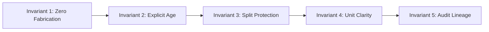

# Financial Data Quality & Validation Rules

## 1. Quality Invariants

MarketScope.io guarantees that no price, financial statement, or corporate action is fabricated or misleadingly labeled. Every data point adheres to five non-negotiable invariants:

1. **Zero Price Fabrication**:
   If an exchange quote is unavailable or market is closed, the system displays the official Previous Close / Settlement price with a clear label. Synthetic or simulated prices are strictly prohibited in production feeds.

2. **Explicit Freshness Labels**:
   - `LIVE_MARKET`: Direct, sub-second to 1-second streaming quote.
   - `DELAYED_15M`: Required by exchange data licensing rules (e.g. LSE, Euronext, TSE without Level 1 subscription).
   - `CALIBRATED_EOD`: Official closing settlement price.
   - `MARKET_CLOSED`: Clearly indicated outside local trading hours.

3. **Split & Corporate Action Adjustment**:
   Historical prices must clearly distinguish between **Adjusted Close** (accounting for stock splits, bonus issues, and cash dividends) and **Unadjusted Traded Prices** to prevent artificial price drop artifacts.

4. **Currency & Unit Normalisation**:
   - Indian Equities: Quoted in `INR`. Financial statements scaled in `INR Crore` (1 Cr = 10,000,000 INR).
   - US Equities: Quoted in `USD`. Financial statements scaled in `USD Millions`.
   - UK Equities: Clearly distinguish between Great Britain Pence (`GBp` / `GBX` e.g. `2450p`) and Pounds (`GBP` e.g. `£24.50`).

5. **Financial Statement Consistency**:
   - Consolidated statements take precedence over Standalone statements for parent corporations (e.g. Reliance, Tata Motors, Alphabet).
   - Balance sheets must satisfy: $\text{Total Assets} = \text{Total Liabilities} + \text{Total Shareholders' Equity}$.
   - Cash flows must verify: $\text{Closing Cash} = \text{Opening Cash} + \text{Net Cash Flow}$.

---

## 2. Ingestion Validation Thresholds

| Metric | Permissible Range | Rejection / Quarantine Action |
|---|---|---|
| Stock Price | > 0.0001 (Positive) | Reject zero or negative prices |
| Day Change % | -99.9% to +500% | Flag circuit-breaker review if > 50% |
| P/E Multiple | 0.0 to 2,000.0 or `None` (Negative earnings) | Nullify if negative, label as Loss-Making |
| ROE (%) | -100% to +500% | Flag for balance-sheet deficit if > 200% |
| ISIN Length | Exactly 12 alphanumeric characters | Reject if length != 12 or country code invalid |
| Week 52 High/Low | Low <= Current Price <= High | Auto-correct 52-week boundaries if breached |
