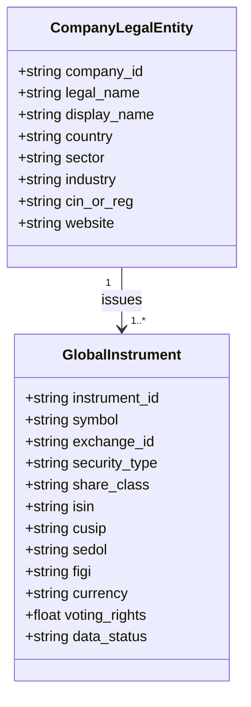

# Global Instrument Master Architecture & Specification

## 1. Overview & Objective

The **Global Instrument Master** is MarketScope.io's authoritative system of record for financial instruments traded across domestic Indian and premier global exchanges. It resolves the fundamental limitation of ticker-only lookups by decoupling the **Legal Entity (Company / Corporate Issuer)** from individual **Exchange Listings (Instruments)**.

---

## 2. Core Entity Separation

### Company Legal Entity (`CompanyLegalEntity`)
Represents the underlying legal corporation incorporated under corporate law (e.g. Companies Act in India, Delaware General Corporation Law in the US). A single company can issue multiple classes of shares, list on multiple exchanges, or issue American Depositary Receipts (ADRs).

Key Attributes:
- `company_id`: Canonical unique identifier (e.g. `comp-tatamotors`, `comp-reliance`, `comp-alphabet`, `comp-infosys`).
- `legal_name`: Full registered statutory name (e.g. `Tata Motors Limited`, `Alphabet Inc.`).
- `display_name`: Normalized investor-facing brand name (e.g. `Tata Motors`, `Alphabet (Google)`).
- `country`: Country of statutory incorporation and corporate headquarters.
- `sector` & `industry`: Canonical industry classification (e.g. Automobiles, Internet & Direct Marketing).

### Exchange Listing (`GlobalInstrument`)
Represents a specific traded financial instrument on a specific regulated trading venue.

Key Attributes:
- `instrument_id`: Deterministic unique identifier structured as `{country_code}-{exchange_id}-{symbol_slug}` (e.g. `in-nse-tatamotors`, `in-nse-tatamtrdvr`, `us-nasdaq-googl`, `us-nasdaq-goog`).
- `company_id`: Foreign key reference to parent `CompanyLegalEntity`.
- `symbol`: Official exchange ticker symbol (e.g. `TATAMOTORS`, `TATAMTRDVR`, `500570`, `GOOGL`, `GOOG`, `INFY`).
- `exchange_id`: Unique identifier of the listing venue matching the Exchange Registry (e.g. `NSE`, `BSE`, `NASDAQ`, `NYSE`, `LSE`).
- `security_type`: Type of security (`EQUITY`, `ADR`, `GDR`, `ETF`, `INDEX`, `COMMODITY`, `CURRENCY`, `BOND`).
- `share_class`: Distinct class specification (e.g. `Ordinary Shares`, `DVR (Differential Voting Rights)`, `Class A Voting`, `Class C Non-Voting`).
- `voting_rights`: Exact voting entitlement per share (e.g. `1.0` for Ordinary, `0.1` for DVR, `0.0` for Non-Voting).
- `isin`: ISO 6166 International Securities Identification Number (12 alphanumeric characters).
- `currency`: Quoting and settlement currency ISO code (`INR`, `USD`, `GBP`, `EUR`, `JPY`, etc.).
- `listing_status`: Operational trading state (`ACTIVE`, `SUSPENDED`, `DELISTED`).
- `data_status`: Transparency status of incoming market data (`LIVE`, `DELAYED_15M`, `CALIBRATED_EOD`, `LICENCE_REQUIRED`).

---

## 3. Disambiguation & Resolution Rules

1. **Multi-Share Class Disambiguation**:
   Companies such as Tata Motors issue both Ordinary Shares (`TATAMOTORS`) and Differential Voting Rights (`TATAMTRDVR`). Each has distinct price discovery, dividend yields, voting powers, and ISINs (`INE155A01022` vs `IN9155A01020`). MarketScope.io maintains separate records and never blends their order books or historical pricing.

2. **Cross-Exchange Disambiguation**:
   Companies such as Reliance Industries trade simultaneously on NSE (`RELIANCE`) and BSE (`500325` / `RELIANCE`). When an end-user queries "RELIANCE", the platform presents all valid trading venues with transparent liquidity indicators, rather than silently discarding one.

3. **Dual-Class Voting Structures**:
   Alphabet Inc. trades on NASDAQ as `GOOGL` (Class A with 1 vote) and `GOOG` (Class C with 0 votes). Both share identical corporate fundamentals and balance sheets, but constitute distinct trading instruments with a measurable voting premium.

4. **ADR / Cross-Border Dual Listings**:
   Infosys Limited trades on the National Stock Exchange of India (`INFY` in INR) and on the New York Stock Exchange as an ADR (`INFY` in USD, ISIN `US4567881085`). The Global Instrument Master links both to `comp-infosys` while isolating currency, settlement cycle, trading calendar, and fee structures.

---

## 4. In-Memory Indexing & Lookup Performance

To guarantee sub-millisecond query responses across the entire application, the `GlobalInstrumentMasterService` maintains four synchronized hash indices:

- `_by_id`: Direct primary key lookup via `instrument_id`.
- `_by_exchange_symbol`: Compound key lookup `(exchange_id, symbol)`.
- `_by_isin`: Exact lookup by ISO 6166 ISIN.
- `_by_company`: Issuer-level aggregation returning all associated listings for cross-listing switchers.

Search operations execute multi-tier relevance scoring (Exact Symbol = 100, Exact ISIN = 95, Symbol Starts With = 90, Company Exact = 85, Token Match = 70, Fuzzy Match = 50) with automated tie-breaking by market capitalisation.
