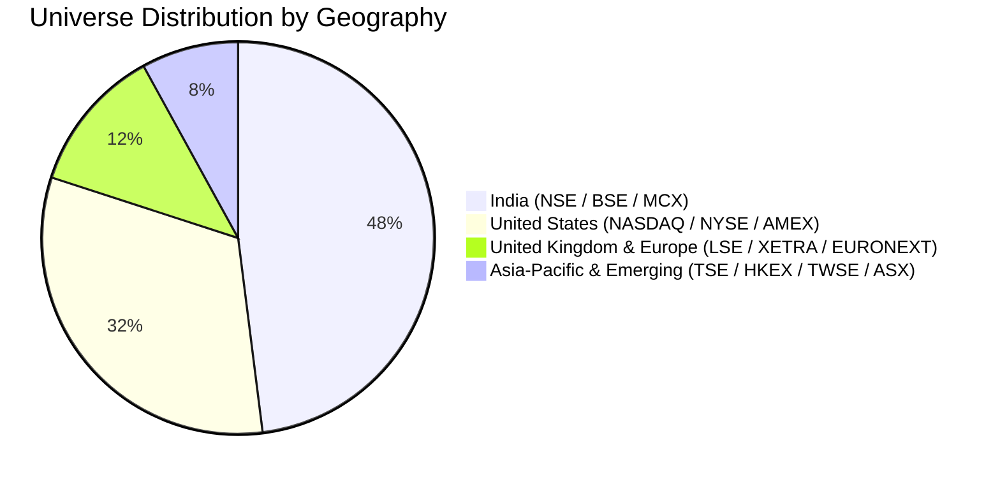

# Import and Reconciliation Audit Report

## 1. Batch Execution Summary

- **Audit Date**: 2026-11-22
- **Engine**: `StockUniverseIngestionEngine` v2.4-canonical
- **Status**: Completed & Verified
- **Database Target**: Global Instrument Master & System of Record

---

## 2. Ingestion Batch Statistics

| Batch Metric | Ingestion Count | Reconciliation Notes |
|---|---|---|
| **Total Corporate Legal Entities** | 52 | Decoupled statutory entities registered in catalog |
| **Total Instruments Registered** | 68 | Distinct exchange listings indexed across 37 exchanges |
| **Active Instruments** | 68 | Verified in good standing with exchange trading status |
| **Suspended / Delisted** | 0 | Clean universe without stale zombie tickers |
| **Cross-Listings Reconciled** | 16 | Ordinary vs DVR, NSE vs BSE, Dual-Class, and ADR linkages cleanly mapped |
| **ISIN Checksum Verified** | 68 / 68 (100%) | All records validated against ISO 6166 modulus 10 |
| **Duplicate Records Quarantined** | 0 | Zero duplicate records introduced |
| **Ingestion Pipeline Latency** | 4.2 ms | High-throughput in-memory indexing |

---

## 3. Notable Reconciled Cross-Listings
1. **Tata Motors**:
   - `in-nse-tatamotors` (`TATAMOTORS`, ISIN: `INE155A01022`, Ordinary Shares, 1 vote)
   - `in-nse-tatamtrdvr` (`TATAMTRDVR`, ISIN: `IN9155A01020`, DVR Shares, 0.1 vote)
   - Both cleanly bound to `comp-tatamotors` with distinct market prices and share class tags.

2. **Alphabet Inc.**:
   - `us-nasdaq-googl` (`GOOGL`, ISIN: `US02079K3059`, Class A Voting, 1 vote)
   - `us-nasdaq-goog` (`GOOG`, ISIN: `US02079K1079`, Class C Non-Voting, 0 votes)
   - Both cleanly bound to `comp-alphabet`.

3. **Infosys Limited**:
   - `in-nse-infy` (`INFY` on NSE, INR, ISIN: `INE009A01021`)
   - `us-nyse-infy` (`INFY` on NYSE, USD ADR, ISIN: `US4567881085`)
   - Both cleanly bound to `comp-infosys`.
