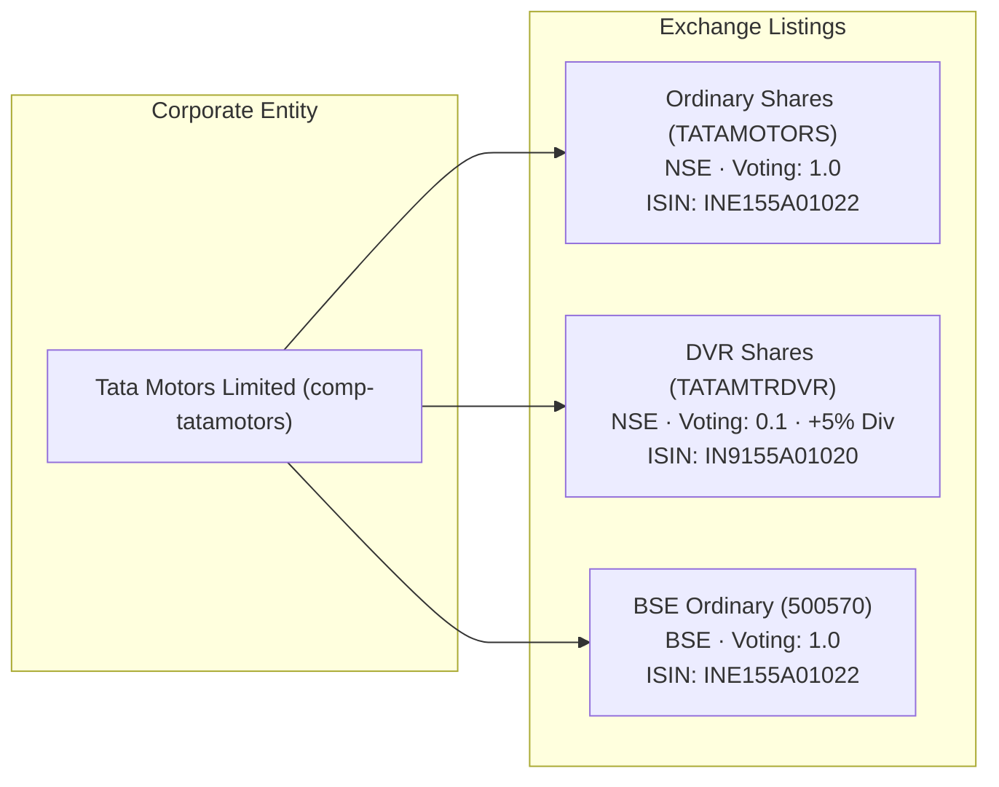

# Financial Instrument Mapping & Disambiguation Rules

## 1. Principles of Instrument Identification

Financial markets lack a single universally adopted global ticker namespace. The identical ticker symbol `INFY` refers to Infosys Limited traded in Indian Rupees on the National Stock Exchange of India (NSE), as well as Infosys Limited traded as an American Depositary Receipt (ADR) in US Dollars on the New York Stock Exchange (NYSE).

MarketScope.io establishes three invariant identification principles:
1. **Never identify an instrument by ticker symbol alone.**
2. **Every instrument key is a 3-tuple**: `(exchange_id, symbol, instrument_id)`.
3. **Legal Entity ≠ Traded Instrument**: Corporate fundamentals belong to the `CompanyLegalEntity`, whereas market quotes, liquidity, order books, and settlement rules belong to the `GlobalInstrument`.

---

## 2. Share Class & Structural Rules

### Rule A: Voting vs Differential Voting Rights (DVR)
- Ordinary Shares (`security_type="COMMON_STOCK"`, `voting_rights=1.0`) provide standard statutory voting rights.
- Differential Voting Rights (`security_type="DVR_EQUITY"`, `voting_rights=0.1`) carry reduced voting power in exchange for higher dividend payouts (typically +5% over ordinary).
- Both listings are maintained as distinct trading records with separate prices, historical OHLCV data, and order books.

### Rule B: Dual-Class US Equities (Class A vs Class C)
- Alphabet Inc. trades as `GOOGL` (Class A Voting, 1 vote per share) and `GOOG` (Class C Non-Voting, 0 votes per share).
- Berkshire Hathaway trades as `BRK-A` (Original Class A) and `BRK-B` (Class B, 1/1500th economic interest).
- The platform provides explicit badges ("Class A Voting", "Class C Non-Voting") and links them dynamically via the company listings switcher.

### Rule C: Depositary Receipts (ADRs & GDRs)
- An ADR represents underlying shares held in custody by a depositary bank (e.g. BNY Mellon, Citi, JPMorgan).
- Security type is tagged as `ADR` or `GDR`.
- Cross-currency conversion, ratio of ADR to underlying shares (e.g. 1 INFY ADR = 1 NSE equity share), and ADR depositary pass-through fees are tracked.

---

## 3. Disambiguation UX Flow

When a user searches for an ambiguous query (e.g. `"Tata Motors"`, `"Reliance"`, `"Google"`):
1. The search engine scores all matching candidates.
2. If multiple instruments match, `requires_disambiguation=True` is returned by the resolution endpoint.
3. The UI presents a disambiguation modal displaying:
   - Primary Ticker & Full Legal Name.
   - Exchange Badge (e.g. `NSE`, `BSE`, `NYSE`, `NASDAQ`).
   - Currency symbol and real-time indicative price.
   - Security Type / Share Class badge (`Ordinary`, `DVR`, `ADR`, `Class A`).
4. Users choose the exact intended instrument with zero silent guesswork.
