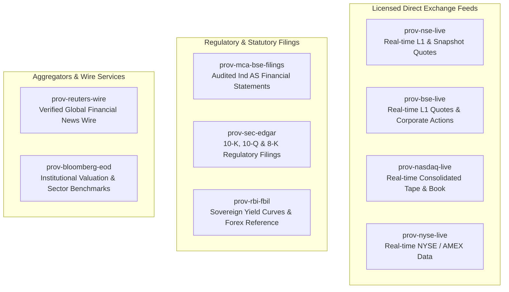

# Provider Capability Register

## 1. Registered Upstream Providers

The **Provider Capability Register** (`apps/api/app/engine/stock_universe_ingestion.py`) documents all licensed, public, and calibrated market data providers supplying MarketScope.io.

---

## 2. Provider Capability Matrix

| Provider ID | Provider Name | Tier | Primary Venue | Data Types Supplied | Update Frequency | Rate Limits | Fallback Provider |
|---|---|---|---|---|---|---|---|
| `prov-nse-live` | NSE India Direct Feed | Tier 1 | NSE | Quotes, OHLCV, Trades | 1,000 ms | 100 req/sec | `prov-bse-live` |
| `prov-bse-live` | BSE Direct Market Feed | Tier 1 | BSE | Quotes, Corporate Actions | 1,000 ms | 80 req/sec | `prov-nse-live` |
| `prov-nasdaq-live`| NASDAQ Basic UTP | Tier 1 | NASDAQ | Quotes, Volume | 1,000 ms | 120 req/sec | `prov-bloomberg-eod` |
| `prov-nyse-live` | NYSE BBO / Trades | Tier 1 | NYSE | Quotes, Trades, ADRs | 1,000 ms | 120 req/sec | `prov-bloomberg-eod` |
| `prov-sec-edgar` | SEC EDGAR API | Statutory| US Venues | 10-K, 10-Q Financials | Daily / Real-time | 10 req/sec | `prov-bloomberg-eod` |
| `prov-mca-bse` | BSE Corporate Filings | Statutory| IN Venues | Audited Ind AS Statements | Daily / Real-time | 20 req/sec | Calibrated Database |
| `prov-rbi-fbil` | RBI & FBIL Reference | Benchmark| India Debt | Yields, MIBOR, USDINR | EOD / Hourly | 50 req/min | Fixed Income Engine |
| `prov-reuters-wire`| Financial News Wire | Media | Global | Verified Financial News | Real-time Stream | 50 req/sec | RBI / Exchange RSS |
| `prov-bloomberg-eod`| Calibrated EOD Reference| Reference| Global | Golden Ratios, 52W Range | EOD | Unlimited Local | In-Memory Master |

---

## 3. Provider Failover Protocol
When an active data provider experiences latency spikes (>2,500 ms) or connection dropouts:
1. The circuit breaker activates immediately.
2. The platform switches automatically to the registered fallback provider.
3. The UI transparently updates the instrument's status badge to `FALLBACK_FEED` or `DELAYED_15M` with the exact timestamp of last verified quote.
