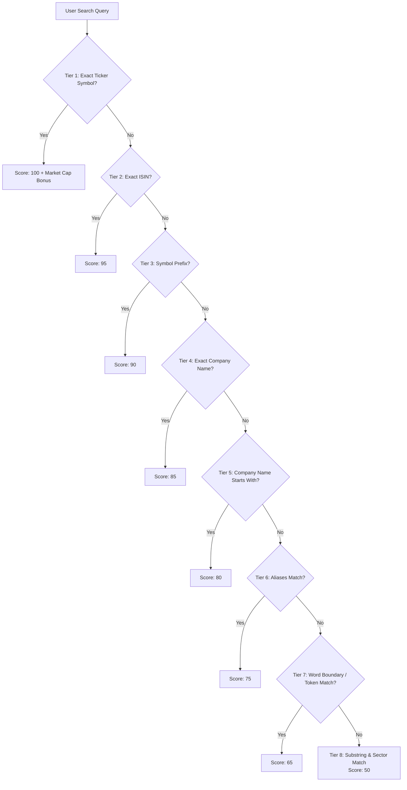

# Server-Side Ranked Universal Search Architecture

## 1. Multi-Tier Ranking Engine

MarketScope.io implements a deterministic 8-tier relevance ranking engine (`search()` in `apps/api/app/engine/global_instrument_master.py`) designed specifically for financial instruments.

### Scoring Formula & Weighting
- **Tier 1 (Exact Symbol)**: Base score `100.0`. E.g. searching `"RELIANCE"` matches `RELIANCE` on NSE.
- **Tier 2 (Exact ISIN)**: Base score `95.0`. Direct 12-character identification (e.g. `"INE002A01018"`).
- **Tier 3 (Symbol Starts With)**: Base score `90.0`. E.g. `"TATA"` matches `TATAMOTORS`, `TATAPOWER`, `TATASTEEL`.
- **Tier 4 (Exact Company Legal Name)**: Base score `85.0`. E.g. `"Tata Consultancy Services"`.
- **Tier 5 (Company Name Starts With)**: Base score `80.0`. E.g. `"Reliance Industries"`.
- **Tier 6 (Curated Aliases)**: Base score `75.0`. E.g. `"Google"` -> `Alphabet Inc.`, `"Facebook"` -> `Meta Platforms`.
- **Tier 7 (Token / Word Boundary)**: Base score `65.0`. Matches distinct words across long corporate titles.
- **Tier 8 (Substring / Sector)**: Base score `50.0`. Fallback matching across sector and industry strings.

### Tie-Breaking by Market Capitalisation
When multiple instruments fall into the same tier (e.g. multiple companies starting with `"TATA"`), the engine adds a calibrated market capitalisation bonus:
$$\text{Bonus} = \min\left(2.5, \frac{\log_{10}(\text{Market Cap} + 1)}{6.0}\right)$$
This ensures benchmark institutional securities float naturally above micro-cap instruments without drowning out exact textual matches.

---

## 2. Cross-Listing Disambiguation UX

The search API returns both the primary matched instrument and an `alternative_listings` array containing any brother or sister listings sharing the same `company_id`.
In the frontend Command Palette (`Ctrl+K`) and Discovery Portal (`/stocks`), instruments with multi-listings display a `Multi-Listed` badge and offer instant switching between listings (e.g. NSE INR equity vs NYSE USD ADR).
