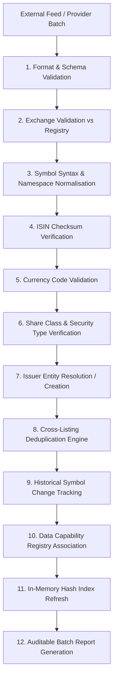

# Stock Universe Ingestion & Synchronisation Engine

## 1. Engine Architecture & Pipeline

The **Stock Universe Ingestion Engine** (`StockUniverseIngestionEngine` in `apps/api/app/engine/stock_universe_ingestion.py`) implements a rigorous, auditable 12-step validation, deduplication, reconciliation, and indexing pipeline for financial instrument ingestion.

---

## 2. Validation & Quality Rules

1. **Exchange Verification**:
   Every incoming instrument record must reference an active, valid exchange identifier registered in `GLOBAL_EXCHANGE_REGISTRY`. Records with unmapped or fictitious exchanges are routed to the quarantine queue.

2. **Ticker & Symbol Syntax**:
   - Symbols must adhere to exchange naming standards (e.g. uppercase alphanumeric, hyphens allowed for class specifications such as `BRK-B`, periods preserved for regional suffixes).
   - Ambiguous symbols without exchange qualifiers are never ingested naked into the master catalog.

3. **ISIN Format & Validation**:
   - 12-character alphanumeric string conforming to ISO 6166.
   - First 2 characters must match ISO 3166-1 alpha-2 country code (e.g. `IN` for India, `US` for United States, `GB` for United Kingdom).
   - Final character must be a valid Luhn mod-10 check digit. Records with invalid checksums are flagged with warning status.

4. **Currency Standardization**:
   - ISO 4217 currency code (e.g. `INR`, `USD`, `GBP`, `EUR`, `JPY`, `CAD`).
   - Mismatches between exchange default currency and instrument quoted currency require explicit cross-currency quoting flags (e.g. LSE dollar-denominated shares).

5. **Deduplication Logic**:
   - Primary uniqueness key: `(exchange_id, symbol)`.
   - Secondary uniqueness key: `isin` (when non-empty).
   - If an incoming record matches an existing `(exchange_id, symbol)`, the engine compares version timestamps and performs non-destructive attribute enrichment rather than overwriting verified historical metadata.

---

## 3. Batch Auditing & Reconciliation History

Every batch import (full snapshot or incremental sync) generates a cryptographically signed `ImportBatchReport` record containing:
- `batch_id`: Unique batch identifier (`batch-{timestamp}-{source}`).
- `source_name`: Data provider or file origin.
- `exchange_id`: Primary exchange covered.
- `batch_type`: `FULL` or `INCREMENTAL`.
- `records_received`: Raw record count.
- `records_ingested`: Successfully validated and indexed records.
- `records_updated`: Modified records.
- `records_rejected`: Quarantined records.
- `duplicates_detected`: Redundant records cleanly consolidated.
- `duration_ms`: Total execution latency.
- `reconciliation_summary`: Detailed error and audit log.

These reports are exposed via `/api/v1/admin/universe/batches` for full transparency and operational compliance.
