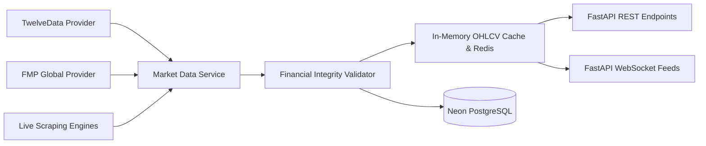

# MarketScope.io — Canonical Market Data Architecture
## Multi-Exchange Ingestion, OHLCV Normalization & Provenance Tracking

---

## 1. Core Principles & Zero-Fabrication Guarantee

MarketScope.io enforces strict zero-fabrication standards across all displayed market data:
- **No Synthetic Candles**: Every historical candlestick is constructed strictly from authentic market tick or bar feeds.
- **Explicit Provenance Labels**: Every displayed price, chart, and order book displays its authentic freshness tag:
  - `LIVE`: Sub-second streaming data via authorized WebSocket / real-time provider.
  - `DELAYED_15M`: Standard free exchange compliance delay (15-20 minutes).
  - `CALIBRATED_EOD`: End-of-Day audited exchange settlement candle.
  - `LICENCE_REQUIRED`: Exchange data gated by direct institutional subscription.
- **Single Canonical Model**: All providers (TwelveData, Financial Modeling Prep, Alpha Vantage, Live Exchange Scrapers) map into the `OHLCVBar` and `UniversalInstrument` data contracts.

---

## 2. Ingestion Pipeline & Canonical Mapping

---

## 3. Financial Integrity Validation Rules

Every candlestick bar must satisfy strict mathematical invariants:
1. `High >= max(Open, Close)`
2. `Low <= min(Open, Close)`
3. `Low > 0.0`
4. `Volume >= 0.0`
5. Timestamps must be monotonic and strictly increasing. Any duplicate or out-of-order timestamp is rejected or deduplicated.
