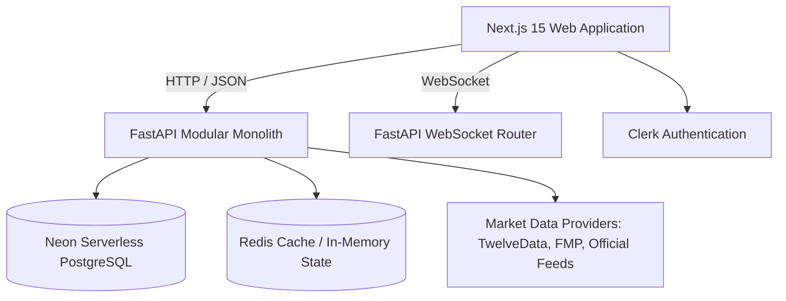

# MarketScope.io — Complete Project Overview

## 1. Product Vision & Mission
**MarketScope.io** is a high-performance financial research, advanced technical charting, and market intelligence platform designed primarily for Indian markets (NSE, BSE, MCX) and expanded to major global exchanges (NASDAQ, NYSE, LSE).

The platform bridges the gap between retail usability and institutional-grade analytics, combining:
1. **TradingView-grade Interactive Charting**: Lightweight Charts v5 with OHLCV bars, multi-timeframe resolution (1m, 5m, 15m, 1D, 1W), 14 technical indicators, 10 drawing tools, and multi-chart split layouts (single, 2-horizontal, 2-vertical, 4-grid) with persistent storage.
2. **Zerodha Kite-grade Fast Market Terminal**: Real-time ticker streaming, options chain ladder with Black-Scholes Greeks, 4-quadrant futures build-up radar, and keyboard shortcuts.
3. **Tickertape-grade Fundamental Scorecards**: 6-pillar fundamental health analysis (Valuation, Growth, Profitability, Financial Health, Red Flags, Ownership), standardized financial statements (Income Statement, Balance Sheet, Cash Flow), and peer valuation matrix.
4. **VerquoAI-grade Market Flow & Quantitative Intelligence**: Market-wide advance/decline breadth, Mansfield Relative Strength vs NIFTY benchmark, intraday setup screener, zero-lookahead strategy backtesting engine, and risk-free virtual paper trading.

---

## 2. Core Pillars & Guardrails
- **Strict Non-Custodial Architecture**: MarketScope.io is an educational, research, and analytical intelligence platform. It does not accept customer deposits, route live brokerage orders, or hold client funds. All order simulations are executed in an isolated virtual paper trading ledger.
- **Absolute Financial Provenance & Transparency**: MarketScope.io never fabricates prices, volume, financial statements, or news articles. Every data point displayed is tagged with its provenance (`LIVE`, `DELAYED_15M`, `CALIBRATED_EOD`, `VERIFIED_OFFICIAL`).
- **Performance First**: Instant page loads via Next.js 15 App Router, React 19 server/client boundaries, Tailwind CSS dark/light theme, and FastAPI asynchronous backend with SQLAlchemy connection pooling.

---

## 3. Technology Architecture Summary

### Frontend Stack:
- Framework: Next.js 15.2.8 (React 19.0.0, TypeScript 5.8.2)
- Styling: Tailwind CSS 3.4.19, Lucide React icons
- Charting: Lightweight Charts v5.3.0
- Auth: Clerk Next.js SDK v7.10.5

### Backend Stack:
- Framework: FastAPI 0.115.0, Uvicorn 0.34.0, Python 3.12+
- Database ORM: SQLAlchemy 2.0 with Psycopg 3 dialect & connection pooling
- Cache & PubSub: Redis 5.2.0 & In-memory async event hubs
- Math & Analytics: NumPy, SciPy (Black-Scholes Greeks, Mansfield RS, CAGR, Sharpe/Sortino)
- Provider Connectors: TwelveData, Financial Modeling Prep (FMP), AlphaVantage, Yahoo Finance
