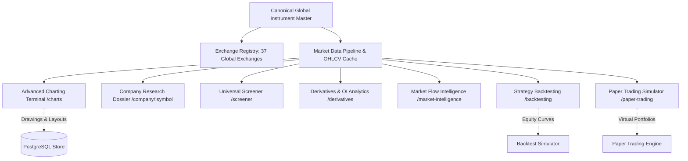

# MarketScope.io — Reference Platform Comparative Analysis
## Comprehensive Structural, Architectural & Functional Benchmark

---

## 1. Executive Summary

MarketScope.io is designed to unify the distinct strengths of four leading financial technology platforms into a cohesive, institutional-grade research and analytics terminal:

1. **TradingView**: Benchmark for high-performance interactive canvas charting, modular technical indicators, geometric drawings, multi-timeframe analysis, and strategy evaluation.
2. **Zerodha Kite**: Benchmark for minimalist, distraction-free execution ergonomics, ultra-fast keyboard-first navigation (`Ctrl+K`), real-time market depth ladders, and derivatives chains.
3. **Tickertape**: Benchmark for structured equity fundamental research, multi-statement financial explorer (Income Statement, Balance Sheet, Cash Flow), 5-pillar investment scorecards, shareholding trends, and multi-factor stock screening.
4. **VerquoAI**: Benchmark for quantitative market flow intelligence, options open interest (OI) analytics (PCR, Max Pain, strike walls), rule-based backtesting simulators, and paper trading environments.

MarketScope.io distinguishes itself by delivering an **integrated, research-only platform with zero financial fabrication, full data provenance, and canonical instrument abstraction across domestic Indian (NSE, BSE, MCX) and international markets (NASDAQ, NYSE, LSE, TSE)**.

---

## 2. Platform Comparison Matrix

| Functional Dimension | TradingView | Zerodha Kite | Tickertape | VerquoAI | MarketScope.io (Target) |
| :--- | :--- | :--- | :--- | :--- | :--- |
| **Primary Domain** | Advanced Charting & Social Ideas | Brokerage Trading & Execution | Indian Equity Research & Screener | Quantitative Options & Backtesting | Universal Financial Research & Charting |
| **Asset Coverage** | Global Multi-Asset (Stocks, Crypto, FX) | Indian Capital Markets (NSE, BSE, MCX) | Indian Equities & Mutual Funds | Indian & US Equities/Options | Indian (NSE, BSE, MCX) + Global (37 Exchanges) |
| **Chart Engine** | Proprietary HTML5 Canvas (Library/Lightweight) | Proprietary / TradingView Integration | Static / Recharts / TradingView Widget | Lightweight Charts / TradingView | Canvas-Rendered Lightweight Charts + Custom Overlays |
| **Indicator Library** | 100+ Indicators + Custom Pine Script | ~30 Standard Indicators | Basic Moving Averages / RSI | ~15 Quantitative Indicators | 20+ Mathematically Verified Indicators |
| **Drawing Tools** | 50+ Geometric, Retracement, Text Tools | ~10 Standard Drawing Tools | Minimal / None | Minimal | 14 Standard Financial Drawing Tools (Persisted) |
| **Multi-Chart Layouts** | 1 to 8 split panes (Pro tier gated) | 2 to 4 split panes | Single view | Single / Dual | 1, 2, 4 split layouts with symbol synchronization |
| **Fundamental Statements** | Standard quarterly/annual tables | Basic financials via Console | Deep 10-year historical tables & ratios | Basic financial metrics | 5-year standardized statements with audit trails |
| **Company Scorecard** | Basic financial ratings | None | 5-pillar scorecard (Valuation, Growth, etc.) | Metric scorecards | 5-pillar quantitative audit scorecards |
| **Shareholding Patterns** | Limited ownership data | Quarterly promoter/FII data | Visual quarterly trend breakdown | Institutional holdings | Promoter, FII, DII, Retail historical trends |
| **Stock Screener** | Global screener with 100+ metrics | None | Multi-metric query builder & presets | Preset algorithmic scans | Multi-criteria screener with presets & CSV export |
| **Derivatives Analytics** | Basic option prices / TV scripts | Compact Option Chain with Greeks | Limited | Deep OI, PCR, Max Pain, IV Smile | Interactive Option Chain, PCR, Max Pain & Greeks |
| **Futures Build-up** | Volume-based | OI & Volume changes | None | Long/Short build-up classification | Automated 4-quadrant build-up classification |
| **Strategy Backtesting** | Pine Script Strategy Tester | Streak integration (external paid) | None | Zero-code backtest simulator | Zero-code rule-based backtesting engine |
| **Paper Trading** | Virtual simulated broker | Virtual trading via third-party | None | Paper trading account | Full virtual account simulation (₹10L / $100K) |
| **Execution Dependency** | Requires broker connection for live trades | Direct broker routing | Redirects to brokers | Simulation / Webhook alerts | **Strictly Research & Simulation (No Brokerage)** |

---

## 3. Deep Architectural Breakdown by Reference Platform

### 3.1. TradingView Reference Analysis
- **Core Strengths**:
  - Unmatched interactive canvas rendering speed (60fps time scale scrubbing, zoom, pinch).
  - Clean separation of main price canvas from secondary oscillator panes (RSI, MACD, Volume).
  - Floating and dockable drawing toolbars with snapping to OHLC price points.
  - State persistence: User drawings, indicator parameters, and chart templates saved per instrument and timeframe.
- **MarketScope Implementation Strategy**:
  - Implement canvas-accelerated charting via Lightweight Charts with responsive timeframes (`1m` to `1M`).
  - Standalone dedicated terminal route at `/charts` with top bar controls (Timeframes, Chart Types, Indicators, Layouts, Symbol Search, Bar Replay) and left geometric drawing toolbar.
  - User drawings persisted to `/api/v1/chart/drawings` keyed by `(instrument_id, timeframe)`.
  - Indicators calculated server-side or on web worker with exact mathematical formulas (Wilder's RSI, Exponential Smoothing, True Range).

### 3.2. Zerodha Kite Reference Analysis
- **Core Strengths**:
  - Extreme speed and minimalist layout: dark theme (`#121826` / `#0b0f17`), monospace price readouts, high contrast bid-ask colors.
  - Universal Quick Command Palette (`Ctrl+K` / `/` shortcut) allowing instantaneous symbol jumping.
  - Compact market depth ladder showing Level 2 bid/ask liquidity, spread, total buy/sell quantities.
  - Clear keyboard shortcuts for timeframe switching, tool activation, and search focus.
- **MarketScope Implementation Strategy**:
  - High-performance debounced Command Palette in `NavigationShell.tsx` and `/charts` route.
  - Level-2 bid/ask depth ladder component displaying simulated or live liquidity depth with real-time spread analysis.
  - Keyboard shortcuts (`1`, `5`, `15`, `D`, `W`, `M` for timeframe, `F` for fullscreen, `/` for search).

### 3.3. Tickertape Reference Analysis
- **Core Strengths**:
  - Structured 5-Pillar Scorecard: Valuation, Profitability, Growth, Financial Health, and Red Flags.
  - Clean three-statement financial model: Income Statement, Balance Sheet, Cash Flow with 5-year CAGRs.
  - Visual shareholding patterns showing institutional migration over consecutive quarters.
  - Peer comparison table normalizing P/E, P/B, EV/EBITDA, ROE, Market Cap across sector peers.
  - Stock Screener with preset screens (e.g. "Near 52-week High", "High Dividend Yield", "Undervalued Growth").
- **MarketScope Implementation Strategy**:
  - Comprehensive company dossier at `/company/[symbol]` with dynamic tabs: Overview, Chart, Financials, Scorecard, Peers, Shareholding.
  - Server-side multi-metric screener engine at `apps/api/app/engine/screener_engine.py` with presets and interactive filter builder at `/screener`.
  - Traceable financial facts anchored to canonical SEC/MCA filing dates with audit citations.

### 3.4. VerquoAI Reference Analysis
- **Core Strengths**:
  - Market Flow & Relative Strength: Real-time scan of top gainers, losers, 52-week high/low breakouts, and sector leadership.
  - Options Open Interest Pulse: Aggregated Put-Call Ratio (PCR), Max Pain calculation, Call/Put strike resistance walls.
  - Futures Build-up Engine: Real-time categorization into Long Build-up, Short Build-up, Short Covering, and Long Unwinding.
  - Quantitative Backtesting: Strategy evaluation with metrics (CAGR, Sharpe, Max Drawdown, Win Rate, Profit Factor) without coding.
  - Paper Trading: Virtual cash balance and execution simulation to test hypotheses without financial risk.
- **MarketScope Implementation Strategy**:
  - Quantitative intelligence suite at `/derivatives`, `/market-intelligence`, `/backtesting`, and `/paper-trading`.
  - High-precision options chain engine computing strike-level Greeks (Delta, Gamma, Theta, Vega) via Black-Scholes.
  - Deterministic backtest simulator accounting for zero-lookahead, realistic slippage, and brokerage/STT costs.
  - Full virtual portfolio state management with persistent orders and marked-to-market valuations.

---

## 4. MarketScope.io Architectural Synthesis

MarketScope.io ties these four pillars together via a **Single Canonical Instrument Master**:

By decoupling company legal entities from multi-exchange listings, MarketScope.io guarantees that data remains accurate whether an investor is analyzing an NSE-listed blue-chip in Mumbai or a dual-listed ADR in New York.
